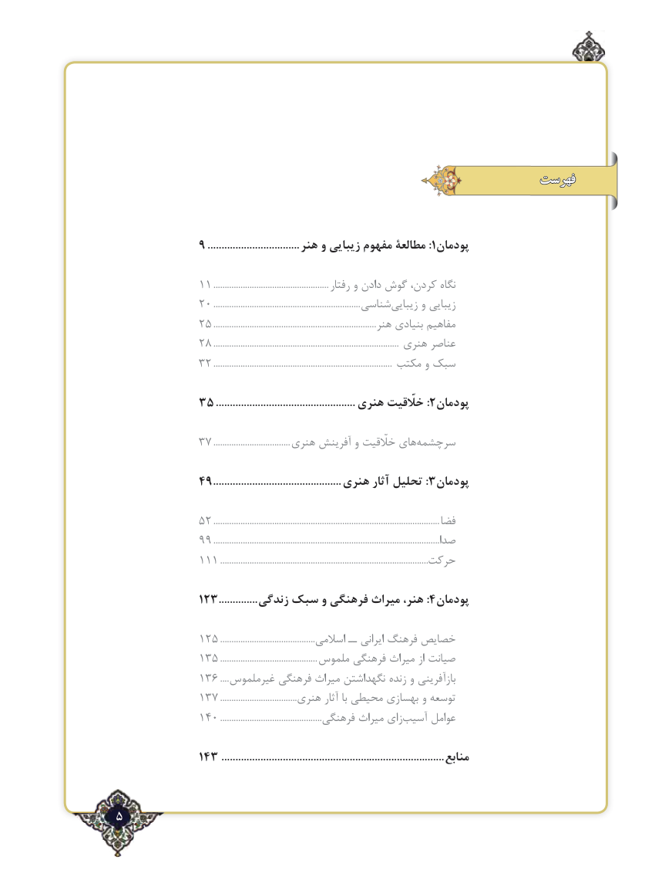

# PDF page 5

فهرست

             9..................................:هنر و زیبایی مفهوم مطالعۀ 1پودمان

                                   11................................................... رفتار و دادن گوش كردن، نگاه
                                   20................................................................. شناسي‌زيبايي و زيبايي
                                   2.5....................................................................... هنر بنيادي مفاهيم
                                    2.8................................................................................. هنري عناصر
                                    32............................................................................... مكتب و سبك

                   35..................................................:هنری خلّقیت 2پودمان

                                 .73................................. هنري آفرينش و خلّقيت هاي‌سرچشمه

                  49..............................................:هنری آثار تحلیل 3پودمان

                                    52.................................................................................................... فضا
                                    .99...................................................................................................صدا
                                    111.............................................................................................حركت

       123..............:زندگی سبک و فرهنگی میراث هنر، 4پودمان

                                  12.5.......................................... اسالمي ــ ايراني فرهنگ خصايص
                                  1.53........................................... ملموس فرهنگي ميراث از صيانت
                       1.63.... غيرملموس فرهنگي ميراث نگهداشتن زنده و بازآفريني
                                 1.73.................................. هنري آثار با محيطي بهسازي و توسعه
                                  140.............................................. فرهنگي ميراث زاي‌آسيب عوامل

                             143................................................................................. منابع

٢5

