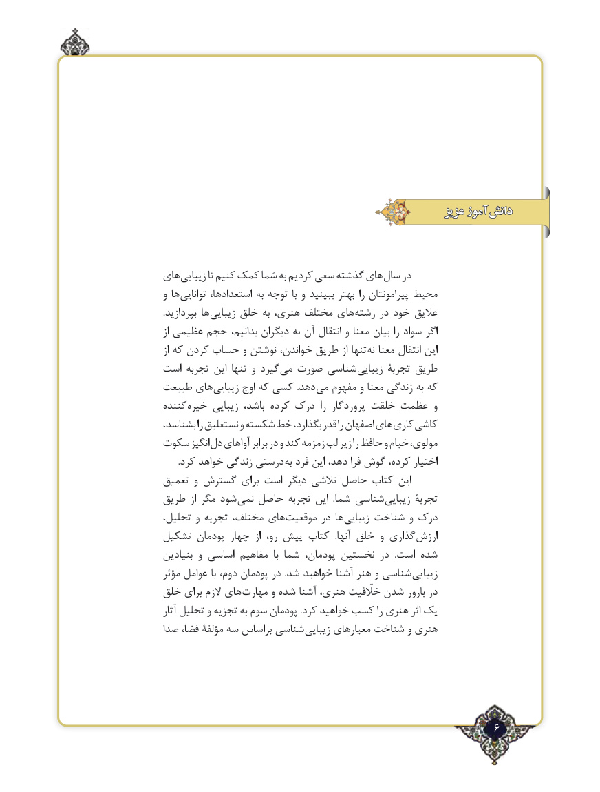

# PDF page 6

عزيزعزيز آموزآموز  دانشدانش

هاي زيبايي تا كنيم كمك شما به كرديم سعي گذشته هاي سال در
و ها توانايي استعدادها، به توجه با و ببينيد بهتر را پيرامونتان محيط
.بپردازيد ها زيبايي خلق به هنری، مختلف هاي رشته در خود عاليق
از عظيمي حجم بدانيم، ديگران به آن انتقال و معنا بيان را سواد اگر
از كه كردن حساب و نوشتن خواندن، طريق از تنها نه معنا انتقال اين
است تجربه اين تنها و گيرد مي صورت شناسي زيبايي تجربۀ طريق
طبيعت هاي زيبايي اوج كه كسي .دهد مي مفهوم و معنا زندگي به كه
كننده خيره زيبايي باشد، كرده درك  را پروردگار خلقت عظمت و
بشناسد، را نستعليق و شكسته خط بگذارد، قدر را اصفهان هاي كاري كاشي
سكوت انگيز دل آواهاي برابر در و كند زمزمه لب زير را حافظ و خيام مولوي،
       .كرد خواهد زندگي درستي به فرد اين‌،گوشدهد فرا        ‌،اختياركرده
تعميق و گسترش براي است ديگر تالشي حاصل كتاب اين
طريق از مگر شود نمي حاصل تجربه اين  .شما شناسي زيبايي تجربۀ
تحليل، و تجزيه مختلف، هاي موقعيت در ها زيبايي شناخت و درك
تشكيل پودمان چهار  از رو، پيش كتاب  .آنها خلق و گذاري ارزش
بنيادين و اساسي مفاهيم  با شما پودمان، نخستين در  .است شده
مؤثر عوامل با دوم، پودمان در  .شد خواهيد آشنا هنر و شناسي زيبايي
خلق براي الزم هاي مهارت و شده آشنا هنري، خااّلّقيت شدن بارور در
آثار تحليل و تجزيه به سوم پودمان .كرد خواهيد كسب را هنري اثر يك
صدا فضا، مؤلفۀ‌   سه براساس شناسي زيبايي معيارهاي شناخت و هنري

                                                      ٢6

