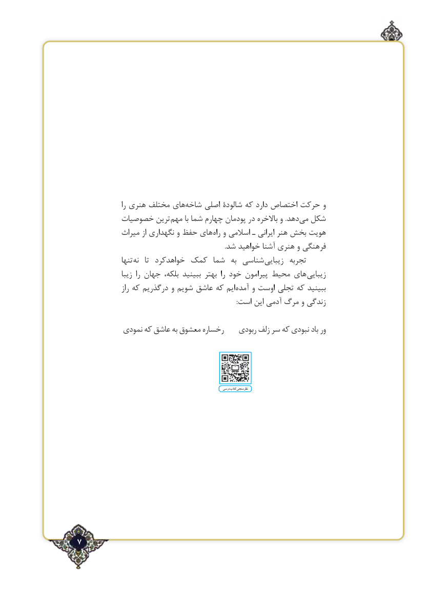

# PDF page 7

را هنری مختلف هایشاخه‌    اصلی شالودۀ كه دارد اختصاص حرکت و
          خصوصيات ترین مهم با شما چهارم پودمان در باالخره و .دهدمی‌  شکل
            ميراث از نگهداري و حفظ هاي راه و اسالمی ـ ایرانی هنر بخش هویت
                                                                                           .شد خواهيد آشنا هنري و فرهنگي
                تنها نه   تا  خواهدكرد كمك شما  به شناسي زيبايي  تجربه
                 زيبا  را جهان بلكه، ببينید بهتر  را خود پيرامون محيط هاي زيبايي
                  راز كه درگذريم و شويم عاشق كه ايم آمده و اوست تجلي كه ببينيد
                                                                                                  :است اين آدمي مرگ و زندگي

            نمودی كه عاشق به معشوق رخساره    ربودي زلف سر كه نبودي باد ور

                                                                                  درسی کتاب نظرسنجی

٢7

