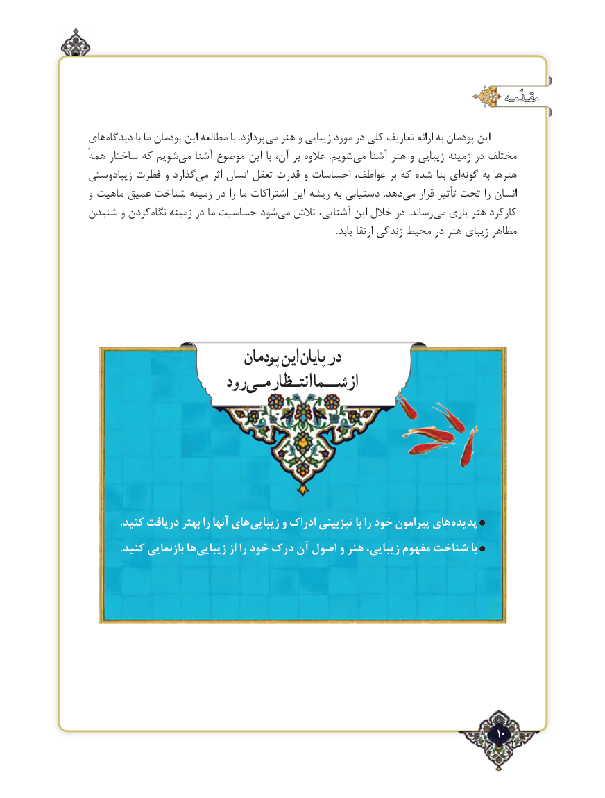

# PDF page 10

مقـدّمـهمقـدّمـه

های‌دیدگاه با ما پودمان این مطالعه با .پردازد‌می هنر و زیبایی مورد در کلی تعاریف ارائه به پودمان این
همهٔ ساختار که شویم ‌می آشنا موضوع این با آن، بر عالوه  .شویم‌می آشنا هنر و زیبایی زمینه در مختلف
زیبادوستی فطرت و گذاردمی‌    اثر انسان تعقل قدرت و احساسات عواطف، بر که شده بنا ای‌گونه به هنرها
و ماهیت عمیق شناخت زمینه در را ما اشتراکات این ریشه به دستیابی  .دهدمی‌    قرار تأثیر تحت را انسان
شنیدن و کردننگاه‌   زمینه در ما حساسیت شود ‌می تالش آشنایی، این خالل در .رساند‌می یاری هنر کارکرد
                                                                                                                .یابد ارتقا زندگی محیط در هنر زیبای مظاهر

                          پودمان اینپایان در
                    رود انتـظارمـیشــمااز

            .کنید دریافت بهتر را آنها های زیبایی و ادراک تیزبینی با را خود پیرامون های پدیده
            .کنید بازنمایی هازیبایی‌        از را خود درک آن اصول و هنر زیبایی، مفهوم شناخت با

                                                                  ٢10

