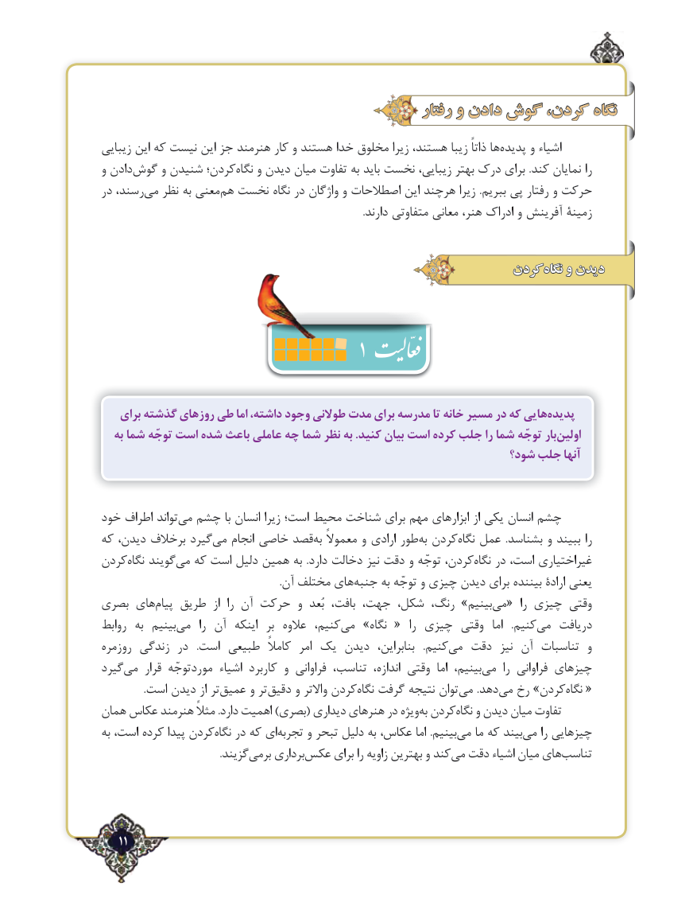

# PDF page 11

رفتار و دادن گوش کردن، نگاه
زیبایی این که نیست این جز هنرمند کار و هستند خدا مخلوق زیرا هستند، زیبا ذاتاً ها‌پديده و اشیاء
و دادن‌گوش و شنیدن کردن؛نگاه‌   و دیدن میان تفاوت به باید نخست زیبایی، بهتر درک برای .کند نمایان را
در رسند، می‌   نظر به معنیهم‌  نخست نگاه در واژگان و اصطالحات این هرچند زیرا .ببریم پی رفتار و حرکت
                                                                                                       .دارند متفاوتی معانی هنر، ادراک و آفرینش زمینة

                                                      کردن‌نگاه و دیدن
                                              1
    برای گذشته روزهای طی اما داشته، وجود طوالنی مدت برای مدرسه تا خانه مسیر در که هاییپدیده‌
   به شما توجّه است شده باعث عاملی چه شما نظر به .کنید بیان است ‌کرده جلب را شما توجّه باراولین‌
                                                              شود؟ جلب آنها

خود اطراف تواندمی‌  چشم با انسان زیرا است؛ محیط شناخت برای مهم ابزارهای از یکی انسان چشم
که دیدن، برخالف گیردمی‌   انجام خاصی قصدبه‌  معموالً و ارادی طوربه‌ کردننگاه‌   عمل  .بشناسد و ببیند را
کردننگاه‌   گویندمی‌  که است دلیل همین به  .دارد دخالت نیز دقت و توجّه کردن،نگاه‌   در است، غیراختیاری
                                                                      .آن مختلف هایجنبه‌     به توجّه و چیزی دیدن برای بیننده ارادة یعنی
بصری های‌پیام طریق  از  را آن حرکت و  بُعد بافت، جهت،‌ ،بینیمشکل رنگ، »   می‌  «  را چیزی وقتی
روابط  به  بینیممی‌     را آن  اینکه  بر  عالوه  کنیم،می‌   »نگاه  ‌«  را چیزی وقتی  اما   .کنیممی‌   دریافت
روزمره زندگی در   .است طبیعی  کامالً  امر یک دیدن  بنابراین،   .کنیم‌می دقت  نیز آن تناسبات  و
گیرد‌می  قرار موردتوجّه اشیاء کاربرد و فراوانی تناسب،  اندازه، وقتی  اما بینیم،می‌     را فراوانی چیزهای
 .‌است دیدن از تر عمیق و تر ‌دقیق و واالتر کردن‌نگاه گرفت نتیجه توانمی‌      .دهد ‌می رخ »کردننگاه‌     ‌«
همان عکاس هنرمند مثالً .دارد اهمیت )بصری( دیداری هنرهای در ویژهبه‌ کردننگاه‌   و دیدن میان تفاوت
به است، کرده پیدا کردننگاه‌   در که ایتجربه‌     و تبحر دلیل به عکاس، اما .بینیممی‌   ما که بیندمی‌    را چیزهایی
                                               .گزیندبرمی‌    برداریعکس‌     برای را زاویه بهترین و کندمی‌  دقت اشیاء میان هایتناسب‌

  ٢11

