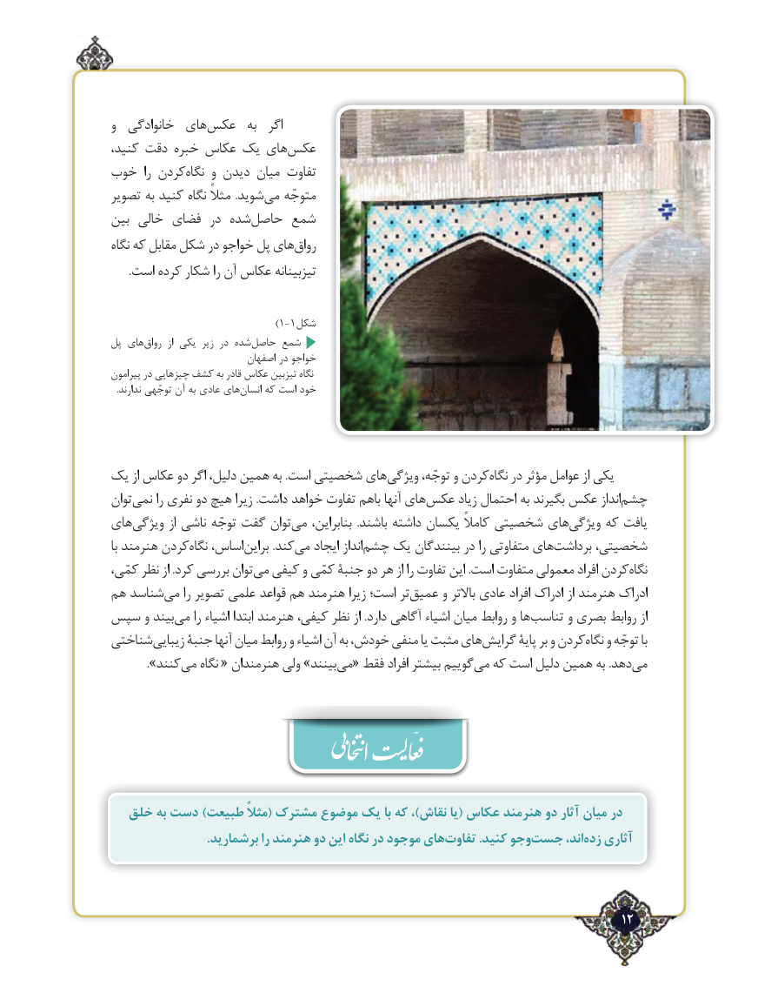

# PDF page 12

و  خانوادگی  هایعکس‌       به  اگر
کنید، دقت خبره عکاس یک هایعکس‌
خوب  را کردننگاه‌    و دیدن میان تفاوت
تصویر به کنید نگاه مثالً .شویدمی‌   متوجّه
بین خالی فضای در شدهحاصل‌    شمع
نگاه که مقابل شکل در خواجو پل هایرواق‌
      .است کرده شکار را آن عکاس تیزبینانه

                                )1-1شکل
پل های‌رواق  از یکی زیر در شده‌حاصل  ‌شمع
                            اصفهان در خواجو
پیرامون در چیزهایی کشف به قادر عکاس تیزبین نگاه
.‌ندارند توجّهی آن به عادی های انسان که است خود

یک از عکاس دو اگر دلیل، همین به .است شخصیتی هایویژگی‌      توجّه، و کردننگاه‌   در مؤثر عوامل از یکی
تواننمی‌     را نفری دو هیچ زیرا .داشت خواهد تفاوت باهم آنها هایعکس‌      زیاد احتمال‌به بگیرند عکس اندازچشم‌
هایویژگی‌        از ناشی توجّه گفت توانمی‌    بنابراین،  .باشند داشته یکسان کامالً شخصیتی هایویژگی‌     که یافت
با هنرمند کردننگاه‌   اساس،براین‌         .کندمی‌   ایجاد اندازچشم‌   یک بینندگان در را متفاوتی هایبرداشت‌     شخصیتی،
کمّی، نظر از .کرد بررسی توانمی‌  کیفی و کمّی جنبة دو هر از را تفاوت این .است متفاوت معمولی افراد کردننگاه‌
هم شناسدمی‌    را تصویر علمی قواعد هم هنرمند زیرا است؛ ترعمیق‌     و باالتر عادی افراد ادراک از هنرمند ادراک
سپس و بیندمی‌    را اشیاء ابتدا هنرمند کیفی، نظر از .دارد آگاهی اشیاء میان روابط و هاتناسب‌      و بصری روابط از
شناختیزیبایی‌     جنبة آنها میان روابط و اشیاء آن به خودش، منفی یا مثبت هایگرایش‌       پایة بر و کردننگاه‌   و توجّه با
   ».‌کنندمی نگاه « هنرمندان ولی »بینندمی‌  « فقط افراد بیشتر گوییممی‌  که است دلیل همین به .دهدمی‌

  خلق به دست )طبیعت مثالً( مشترک موضوع یک با که ،)نقاش یا( عکاس هنرمند دو آثار میان در
 .‌برشمارید را هنرمند دو این نگاه در موجود هایتفاوت .کنید وجوجست‌       اند،‌   آثاری                                      زدهّ

                                                                  ٢12

