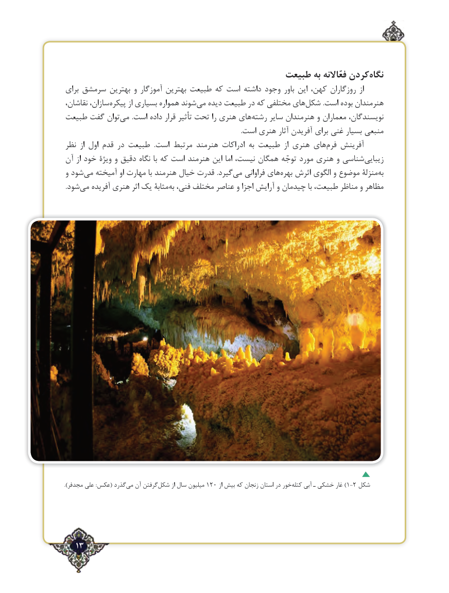

# PDF page 13

طبیعت به فعّاالنه کردن‌نگاه
برای سرمشق بهترین و آموزگار بهترین طبیعت که است داشته وجود باور این کهن، روزگاران از
نقاشان، سازان،‌پیکره از بسیاری همواره شوند‌می دیده طبیعت در که مختلفی های ‌شکل .است بوده هنرمندان
طبیعت گفت توان ‌می  .است داده قرار تأثیر تحت را هنری های‌رشته سایر هنرمندان و معماران نویسندگان،
                                                                                                            .است هنری آثار آفریدن برای غنی بسیار منبعی
نظر  از اول قدم در طبیعت  .است مرتبط هنرمند ادراکات به طبیعت  از هنری های ‌فرم آفرینش
آن از خود ویژة و دقیق نگاه با که است هنرمند این اما نیست، همگان توجّه مورد هنری و شناسی‌زیبایی
و شود ‌می آمیخته او مهارت با هنرمند خیال قدرت .گیردمی‌   فراوانی های‌بهره اثرش الگوی و موضوع منزلۀ ‌به
 .شود‌می آفریده هنری اثر یک مثابۀ ‌به فنی، مختلف عناصر و اجزا آرایش و چیدمان با طبیعت، مناظر و مظاهر

.)مجدفر علی :عکس( گذرد‌می آن گرفتنشکل۱۲۰‌       از سال میلیون        از بیش که زنجان استان در خورکتله‌)آبی ـ خشکی غار 1-2 شکل

   13٢

