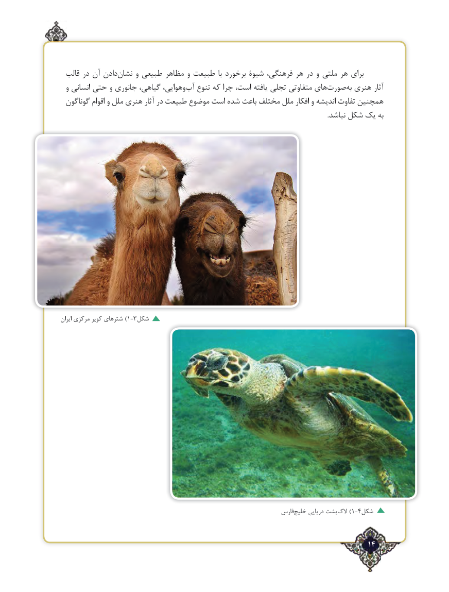

# PDF page 14

قالب در آن دادننشان‌     و طبیعی مظاهر و طبیعت با برخورد شیوة فرهنگی، هر در و ملتی هر برای
  و انسانی حتی و جانوری گیاهی، وهوایی،آب‌   تنوع که چرا است، یافته تجلی متفاوتی هایصورت‌      به‌ هنری آثار
 گوناگون اقوام و ملل هنری آثار در طبیعت موضوع است شده باعث مختلف ملل افکار و اندیشه تفاوت همچنین
                                                                                                                                                                   .نباشد شکل یک به

ایران مرکزی کویر شترهای ) 1-3شکل

                                                                    فارس‌خلیج دریایی پشتالک‌) 1-4شکل

                                                                   ٢14

