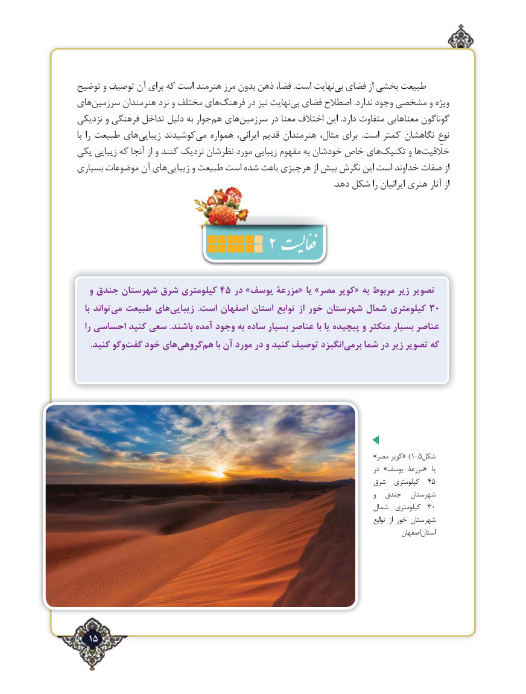

# PDF page 15

توضیح و توصیف آن برای که است هنرمند مرز بدون ذهن فضا، .است نهایتبی‌  فضای از بخشی طبیعت
هایسرزمین‌       هنرمندان نزد و مختلف هایفرهنگ‌      در نیز نهایتبی‌  فضای اصطالح .ندارد وجود مشخصی و ویژه
نزدیکی و فرهنگی تداخل دلیل به جوارهم‌  هایسرزمین‌       در معنا اختالف این .دارد متفاوت معناهایی گوناگون
با را طبیعت هایزیبایی‌     کوشیدندمی‌   همواره ایرانی، قدیم هنرمندان مثال، برای  .است کمتر نگاهشان نوع
یکی زیبایی که آنجا از و کنند نزدیک نظرشان مورد زیبایی مفهوم به خودشان خاص هایتکنیک‌      و هاخلّقیت‌
بسیاری موضوعات آن هایزیبایی‌      و طبیعت است شده باعث هرچیزی از بیش نگرش این است خداوند صفات از
                                                                                                                                      .دهد شکل را ایرانیان هنری آثار از
                                2
   و جندق شهرستان شرق کیلومتری 45 در »یوسف مزرعۀ« یا »مصر کویر« به مربوط زیر تصویر
   با تواندمی‌  طبیعت هایزیبایی‌            .است اصفهان استان توابع از خور شهرستان شمال کیلومتری 30
   را احساسی کنید سعی .باشند آمده وجود به ساده‌    بسیار عناصر با یا پیچیده و متکثر بسیار عناصر
 .‌کنید وگوگفت خود هایگروهی‌    هم‌    با آن مورد در و کنید توصیف انگیزدبرمی‌    شما در زیر تصویر که

                                                                               »مصر کویر« ) 1-5شکل
                                                                                                 در »یوسف مزرعۀ«  یا
                                                                     شرق  کیلومتری  54
                                                                                                      و  جندق  شهرستان
                                                                             شمال  کیلومتری  30
                                                                                                                          توابع  از خور شهرستان
                                                                                                    اصفهاناستان

   15٢

