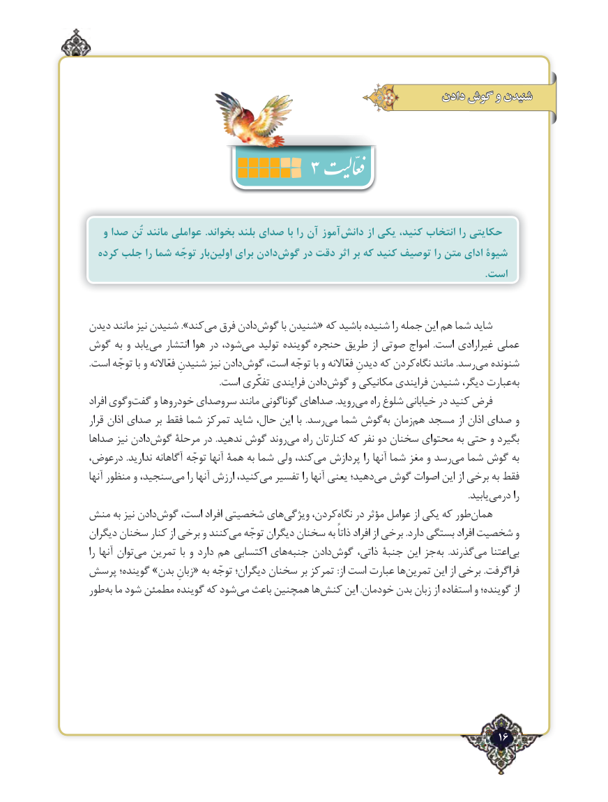

# PDF page 16

دادن گوش و شنیدن
                         3                      4

   و صدا تُن مانند عواملی .بخواند بلند صدای با را آن آموز‌دانش از یکی ،حکایتیکنید انتخاب را
  کرده جلب را شما توجّه بار‌اولین برای دادن‌گوش در دقت اثر بر که کنید توصیف را متن ادای شیوۀ
                                                                                                                                                             .است

دیدن مانند نیز شنیدن ».کندمی‌  فرق دادنگوش‌        با شنیدن« که باشید شنیده را جمله این هم شما شاید
گوش به و یابدمی‌   انتشار هوا در شود،می‌   تولید گوینده حنجره طریق از صوتی امواج  .است غیرارادی عملی
.است توجّه با و فعّاالنه شنیدنِ نیز دادنگوش‌    است، توجّه با و فعّاالنه دیدنِ که کردننگاه‌    مانند .رسدمی‌  شنونده
                                                           .است تفکّری فرایندی دادنگوش‌     و مکانیکی فرایندی شنیدن دیگر، عبارتبه‌
افراد وگویگفت‌    و خودروها سروصدای مانند گوناگونی صداهای .رویدمی‌   راه شلوغ خیابانی در کنید فرض
قرار اذان صدای بر فقط شما تمرکز شاید حال، این با  .رسدمی‌  شما گوشبه‌  زمانهم‌  مسجد از اذان صدای و
صداها نیز دادنگوش‌    مرحلة در .ندهید گوش روندمی‌    راه کنارتان که نفر دو سخنان محتوای به حتی و بگیرد
درعوض، .ندارید آگاهانه توجّه آنها همة به شما ولی کند،می‌  پردازش را آنها شما مغز و رسدمی‌  شما گوش به
آنها منظور و سنجید،می‌    را آنها ارزش کنید،می‌  تفسیر را آنها یعنی دهید؛می‌  گوش اصوات این از برخی به فقط
                               .‌یابیددرمی را
منش به نیز دادنگوش‌    است، افراد شخصیتی هایویژگی‌     کردن،نگاه‌   در مؤثر عوامل از یکی که طورهمان‌
دیگران سخنان کنار از برخی و کنندمی‌   توجّه دیگران سخنان به ذاتاً افراد از برخی .دارد بستگی افراد شخصیت و
را آنها توانمی‌   تمرین با و دارد هم اکتسابی هایجنبه‌    دادنگوش‌     ذاتی، جنبة این جزبه‌    .گذرندمی‌    اعتنابی‌
پرسش گوینده؛ »بدن زبانِ« به توجّه دیگران؛ سخنان بر تمرکز :از است عبارت هاتمرین‌      این از برخی .فراگرفت
طوربه‌  ما شود مطمئن گوینده که شودمی‌  باعث همچنین هاکنش‌     این .خودمان بدن زبان از استفاده و گوینده؛ از

                                                                  ٢16

