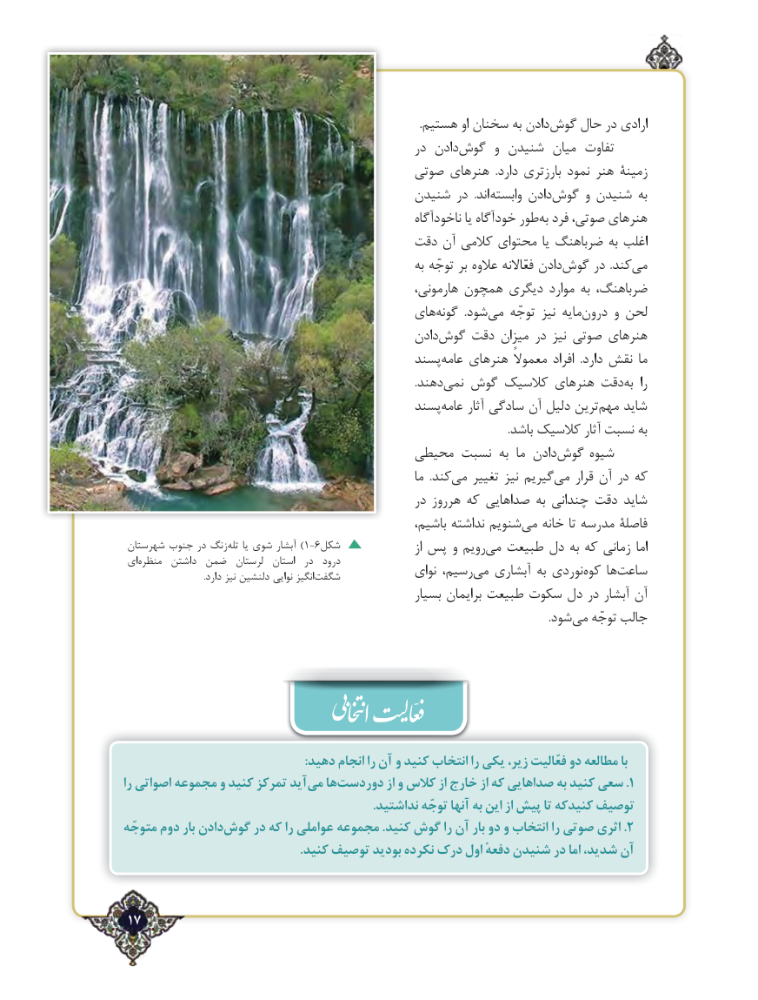

# PDF page 17

.هستیم او سخنان به دادنگوش‌    حال در ارادی
                                                  در دادنگوش‌      و شنیدن میان تفاوت
                                       صوتی هنرهای  .دارد بارزتری نمود هنر ‌ زمینة
                                        شنیدن در  .اند وابسته دادنگوش‌     و شنیدن به
                                                        ناخودآگاه یا خودآگاه طوربه‌  فرد صوتی، هنرهای
                                      دقت آن کالمی محتوای یا ضرباهنگ به اغلب
                                                           به توجّه بر عالوه فعّاالنه دادنگوش‌     در  .کندمی‌
                                                     هارمونی، همچون دیگری موارد به ضرباهنگ،
                                         هایگونه‌         .شودمی‌    توجّه نیز مایهدرون‌     و لحن
                                                دادنگوش‌    دقت میزان در نیز صوتی هنرهای
                                           پسندعامه‌    هنرهای معموالً افراد  .دارد نقش ما
                                                                                                         .دهندنمی‌   گوش کالسیک هنرهای دقتبه‌   را
                                           پسندعامه‌     آثار سادگی آن دلیل ترینمهم‌   شاید
                                                                                                                                           .باشد کالسیک آثار نسبت به
                                     محیطی نسبت به  ما دادنگوش‌    شیوه
                                                              ما  .کندمی‌   تغییر نیز گیریممی‌    قرار آن در که
                                                  در هرروز که صداهایی به چندانی دقت شاید
                                                      باشیم، نداشته شنویممی‌   خانه تا مدرسه فاصلۀ
 شهرستان جنوب در زنگتله‌)یا شوی آبشار 1-6شکل                   از پس و رویممی‌  طبیعت دل به که زمانی اما
 ای‌ه‌منظر  داشتن ضمن  لرستان  استان  در  درود
 .‌دارد نیز دلنشین نوایی انگیزشگفت             نوای رسیم،می‌   آبشاری به نوردیکوه‌    هاساعت‌
                                                      بسیار برایمان طبیعت سکوت دل در آبشار آن
                                                                                                                                                          .شودمی‌   توجّه جالب

                                                          :دهید انجام را آن و کنید انتخاب را یکی ،بازیر فعّالیت دو مطالعه
را اصواتی مجموعه و کنید تمرکز آیدمی‌   هادوردست‌.از و کالس از خارج از که صداهایی به کنید سعی 1
                                                                               .نداشتید توجّه آنها به این از پیش تا کنیدکه توصیف
متوجّه دوم بار دادنگوش‌.در که را عواملی مجموعه .کنید گوش را آن بار دو و انتخاب را صوتی اثری 2
                                                        .    توصیف بودید نکرده درک اول دفعهٔ شنیدن در اما شدید، آن   کنیدّ

 17٢

