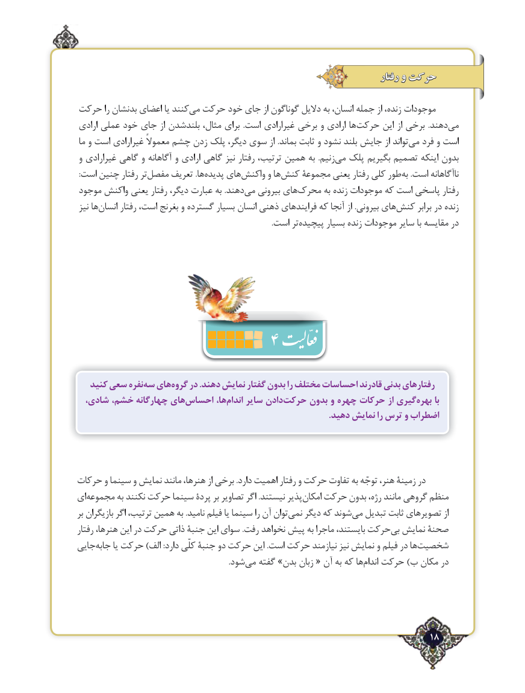

# PDF page 18

رفتار و حرکت

حرکت را بدنشان اعضای یا کنندمی‌  حرکت خود جای از گوناگون دالیل به انسان، جمله از زنده، موجودات
ارادی عملی خود جای از بلندشدن مثال، برای  .است غیرارادی برخی و ارادی هاحرکت‌      این از برخی  .دهندمی‌
 ما و است غیرارادی معموالً چشم زدن پلک دیگر، سوی از .بماند ثابت و نشود بلند جایش از تواندمی‌   فرد و است
و غیرارادی گاهی و آگاهانه و ارادی گاهی نیز رفتار ترتیب، همین به  .زنیممی‌  پلک بگیریم تصمیم اینکه بدون
 :است چنین رفتار ترمفصل‌     تعریف .هاپدیده‌    هایواکنش‌      و هاکنش‌    مجموعة یعنی رفتار کلی طوربه‌   .است ناآگاهانه
موجود واکنش یعنی رفتار دیگر، عبارت به .دهندمی‌   بیرونی هایمحرک‌       به زنده موجودات که است پاسخی رفتار
 نیز هاانسان‌      رفتار است، بغرنج و گسترده بسیار انسان ذهنی فرایندهای که آنجا از .بیرونی هایکنش‌       برابر در زنده
                                                                                                      .است ترپیچیده‌       بسیار زنده موجودات سایر با مقایسه در

                         4
   کنید سعی نفرهسه‌  هایگروه‌    در .دهند نمایش گفتار بدون را مختلف احساسات قادرند بدنی رفتارهای
  شادی، خشم، چهارگانه هایاحساس‌        ها،اندام‌    سایر دادنحرکت‌     بدون و چهره حرکات از گیریبهره‌      با
                                                                                                                    .دهید نمایش را ترس و اضطراب

حرکات و سینما و نمایش مانند هنرها، از برخی .دارد اهمیت رفتار و حرکت تفاوت به توجّه هنر، زمینة در
ایمجموعه‌        به نکنند حرکت سینما پردة بر تصاویر اگر .نیستند پذیرامکان‌   حرکت بدون رژه، مانند گروهی منظم
بر بازیگران اگر ترتیب، همین به .نامید فیلم یا سینما را آن تواننمی‌   دیگر که شوندمی‌  تبدیل ثابت تصویرهای از
رفتار هنرها، این در حرکت ذاتی جنبة این سوای .رفت نخواهد پیش به ماجرا بایستند، حرکتبی‌  نمایش صحنة
جاییجابه‌     یا حرکت )الف :دارد کلّی جنبة دو حرکت این .است حرکت نیازمند نیز نمایش و فیلم در هاشخصیت‌
                                                                               .شودمی‌   گفته »بدن زبان « آن به که هااندام‌   حرکت )ب مکان در

                                                                       18٢

