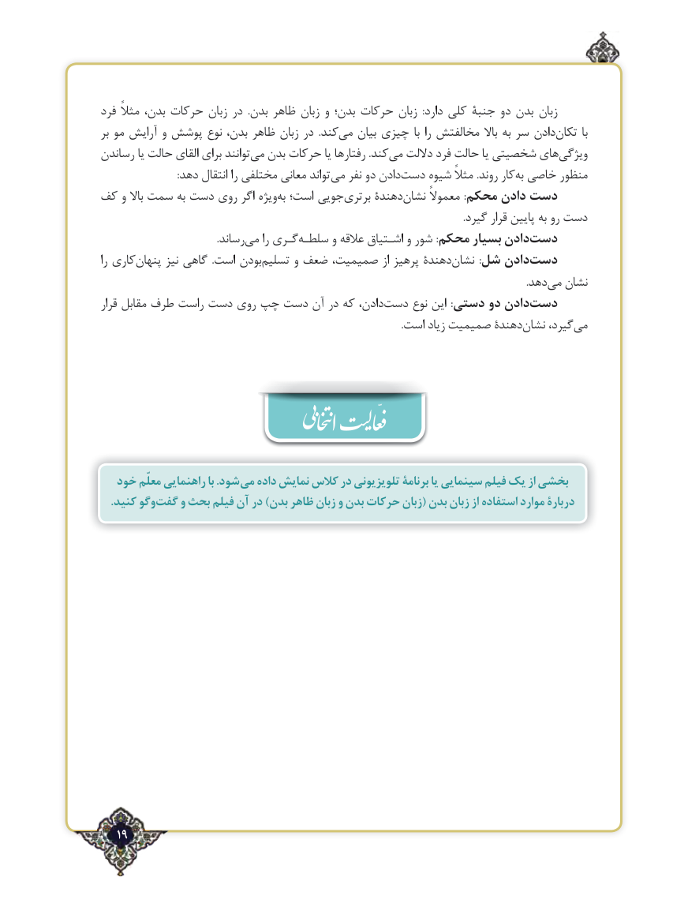

# PDF page 19

فرد مثالً بدن، حرکات زبان در  .بدن ظاهر زبان و بدن؛ حرکات زبان  :دارد کلی جنبة دو بدن زبان
بر مو آرایش و پوشش نوع بدن، ظاهر زبان در  .کندمی‌   بیان چیزی با را مخالفتش باال به سر دادنتکان‌       با
رساندن یا حالت القای برای توانندمی‌  بدن حرکات یا رفتارها .کندمی‌   داللت فرد حالت یا شخصیتی هایویژگی‌
 : دهد انتقال را مختلفی معانی تواند می نفر دو دادندست‌    شیوه مثالً .روند کاربه‌ خاصی منظور
کف و باال سمت به دست روی اگر ویژهبه‌ است؛ جوییبرتری‌     دهندةنشان‌     معموالً :محکم دادن دست
                                                                                                                                                .گیرد قرار پایین به رو دست
                                              .رساندمی‌    را گـریسلطـه‌      و عالقه اشـتیاق و شور :محکم بسیار دادندست‌
را کاریپنهان‌      نیز گاهی  .است بودنتسلیم‌      و ضعف صمیمیت، از پرهیز دهندةنشان‌         :شل دادندست‌
                                  .‌دهدمی نشان
قرار مقابل طرف راست دست روی چپ دست آن در که دادن،دست‌     نوع این  :دستی دو دادندست‌
     .‌است زیاد صمیمیت دهندةنشان گیرد،می‌

  خود معلّم راهنمایی با .شود می داده نمایش کالس در تلویزیونی برنامة یا سینمایی فیلم یک از بخشی
    .کنید وگو ‌    و بحث فیلم آن در )بدن ظاهر زبان و بدن حرکات زبان( بدن زبان از استفاده موارد دربارة گفتّ

   19٢

