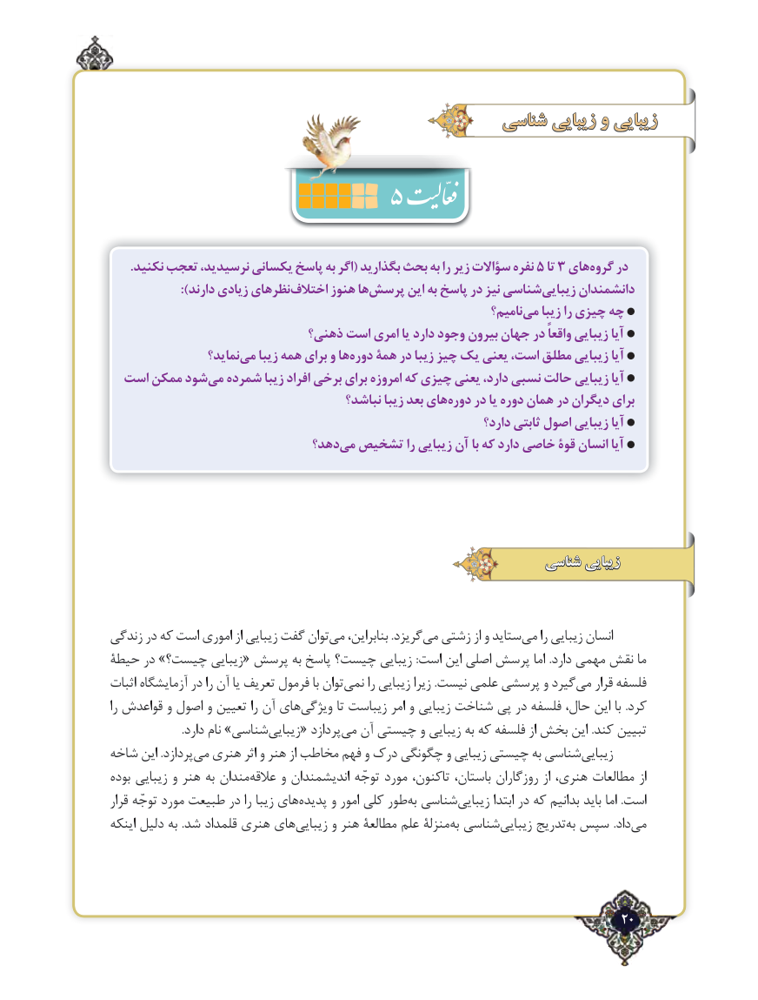

# PDF page 20

شناسی زیبایی و زیبایی
                     5
      .نکنید تعجب نرسیدید، یکسانی پاسخ به اگر( بگذارید بحث به را زیر سؤاالت نفره 5 تا 3 هایگروه‌    در
  ):‌دارند زیادی نظرهایاختالف هنوز هاپرسش‌      این به پاسخ در نیز شناسیزیبایی‌     دانشمندان
                                                                       نامیم؟می‌   زیبا را چیزی چه
                            ذهنی؟ است امری یا دارد وجود بیرون جهان در واقعاً زیبایی آیا
                  نماید؟می‌   زیبا همه برای و هادوره‌   همة در زیبا چیز یک یعنی ،است مطلق زیبایی آیا
  است ممکن شودمی‌  شمرده زیبا افراد برخی برای امروزه که چیزی یعنی ،دارد نسبی حالت زیبایی آیا
                                       نباشد؟ زیبا بعد هایدوره‌    در یا دوره همان در دیگران برای
                                                                    دارد؟ ثابتی اصول زیبایی آیا
                             دهد؟می‌  تشخیص را زیبایی آن با که دارد خاصی قوۀ انسان آیا

                                                            شناسی زیبایی

زندگی در که است اموری از زیبایی گفت توانمی‌   بنابراین، .گریزدمی‌  زشتی از و ستایدمی‌    را زیبایی انسان
حیطة در »چیست؟ زیبایی« پرسش به پاسخ چیست؟ زیبایی :است این اصلی پرسش اما .دارد مهمی نقش ما
اثبات آزمایشگاه در را آن یا تعریف فرمول با تواننمی‌     را زیبایی زیرا .نیست علمی پرسشی و گیردمی‌   قرار فلسفه
را قواعدش و اصول و تعیین را آن هایویژگی‌        تا زیباست امر و زیبایی شناخت پی در فلسفه حال، این‌     با .کرد
  .‌دارد نام »شناسیزیبایی« پردازدمی‌  آن چیستی و زیبایی به که فلسفه از بخش این .کند تبیین
شاخه این .پردازدمی‌  هنری اثر و هنر از مخاطب فهم و درک چگونگی و زیبایی چیستی به شناسیزیبایی‌
بوده زیبایی و هنر به مندانعالقه‌     و اندیشمندان توجّه مورد تاکنون، باستان، روزگاران از هنری، مطالعات از
قرار توجّه مورد طبیعت در را زیبا هایپدیده‌     و امور کلی طوربه‌ شناسیزیبایی‌        ابتدا در که بدانیم باید اما .است
اینکه دلیل به .شد قلمداد هنری هایزیبایی‌      و هنر مطالعة علم منزلۀبه‌ شناسیزیبایی‌     تدریجبه‌ سپس .دادمی‌

                                                                  ٢20

