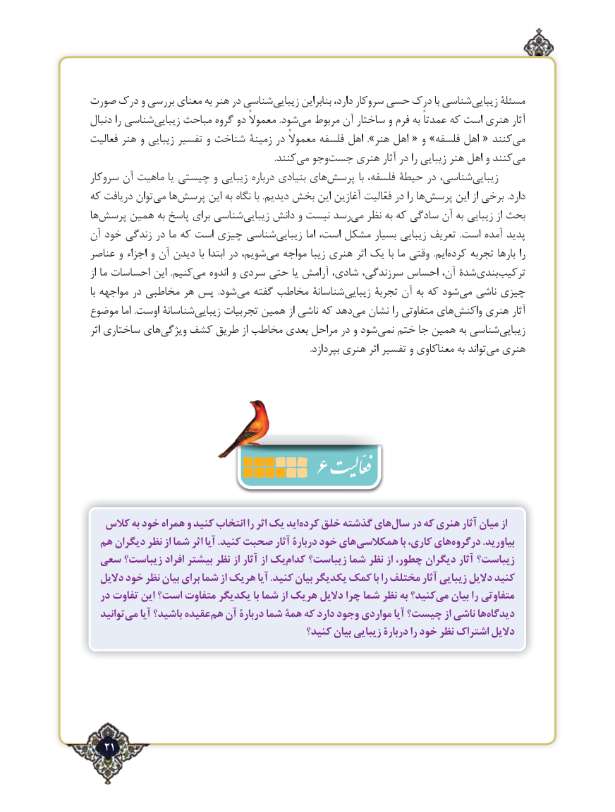

# PDF page 21

صورت درک و بررسی معنای به هنر در شناسیزیبایی‌       بنابراین دارد، سروکار حسی درک با شناسیزیبایی‌     مسئلة
دنبال را شناسیزیبایی‌    مباحث گروه دو معموالً .شودمی‌  مربوط آن ساختار و فرم به عمدتاً که است هنری آثار
فعالیت هنر و زیبایی تفسیر و شناخت زمینة در معموالً فلسفه اهل ».هنر اهل « و »فلسفه اهل « کنند می
                                                                                  .کنندمی‌  وجوجست‌    هنری آثار در را زیبایی هنر اهل و کنندمی‌
سروکار آن ماهیت یا چیستی و زیبایی درباره بنیادی هایپرسش‌          با فلسفه، حیطۀ در شناسی،زیبایی‌
که دریافت توانمی‌   هاپرسش‌      این به نگاه با .دیدیم بخش این آغازین فعّالیت در را هاپرسش‌      این از برخی .دارد
هاپرسش‌     همین به پاسخ برای شناسیزیبایی‌     دانش و نیست رسدمی‌   نظر به که سادگی آن به زیبایی از بحث
آن خود زندگی در ما که است چیزی شناسیزیبایی‌        اما است، مشکل بسیار زیبایی تعریف  .است آمده پدید
عناصر و اجزاء و آن دیدن با ابتدا در شویم،می‌   مواجه زیبا هنری اثر یک با ما وقتی  .ایمکرده‌    تجربه بارها را
از ما احساسات این  .کنیممی‌   اندوه و سردی حتی یا آرامش شادی، سرزندگی، احساس آن، شدةبندی‌   ترکیب‌
با مواجهه در مخاطبی هر پس  .شودمی‌   گفته مخاطب شناسانةزیبایی‌      تجربة آن به که شودمی‌   ناشی چیزی
موضوع اما .اوست شناسانةزیبایی‌     تجربیات همین از ناشی که دهدمی‌  نشان را متفاوتی هایواکنش‌     هنری آثار
اثر ساختاری هایویژگی‌   کشف طریق از مخاطب بعدی مراحل در و شودنمی‌   ختم جا همین به شناسیزیبایی‌
                                                                                                  .بپردازد هنری اثر تفسیر و معناکاوی به تواندمی‌  هنری

                     6
   کالس به خود همراه و کنید انتخاب را اثر یک ایدکرده‌   خلق گذشته هایسال‌   در که هنری آثار میان از
  هم دیگران نظر از شما اثر آیا .کنيد صحبت آثار دربارۀ خود هایهمکالسی‌              با كاري، هايدرگروه‌           .بیاورید
 سعي زيباست؟ افراد بيشتر نظر از آثار از يككدام‌    زيباست؟ شما نظر از چطور، ديگران آثار زیباست؟
  داليل خود نظر بيان براي شما از هريك آيا .کنيد بیان يكديگر كمك با را مختلف آثار زیبایی دالیل كنيد
  در تفاوت این است؟ متفاوت یکدیگر با شما از هريك دالیل چرا شما نظر به كنيد؟مي‌   بيان را متفاوتي
  توانيدمي‌   آيا باشيد؟ عقيدههم‌  آن دربارۀ شما همۀ كه دارد وجود مواردي آيا چیست؟ از ناشی هادیدگاه‌
                                           كنيد؟ بيان زيبايی دربارۀ را خود نظر اشتراك داليل

   21٢

