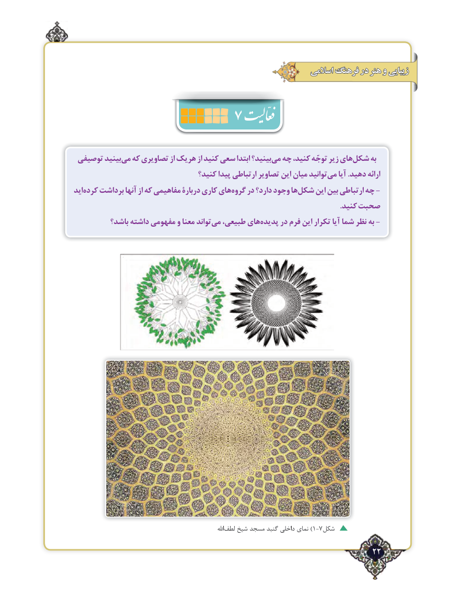

# PDF page 22

اسالمی فرهنگ در هنر و زیبایی
                     7

 توصیفی بينيدمي‌  كه تصاويري از هريك از كنيد سعي ابتدا بينید؟مي‌  چه ،های‌کنید توجّه زیر  شکل‌     به
                                 كنيد؟ پيدا ارتباطی تصاوير اين میان توانيدمی‌   آيا .دهيد ارائه
ايدکرده‌   برداشت آنها از که مفاهیمی دربارۀ كاري هايگروه‌    در دارد؟ وجود هاشکل‌     این بین ارتباطی چه -
                                                                                                                                             .کنید صحبت
          باشد؟ داشته مفهومی و معنا تواندمی‌  طبیعی، هایپدیده‌     در فرم این تکرار آیا شما نظر به -

                                                                                        اهلل‌)لطف شیخ مسجد گنبد داخلی نمای 1-7شکل
                                                                 22٢

