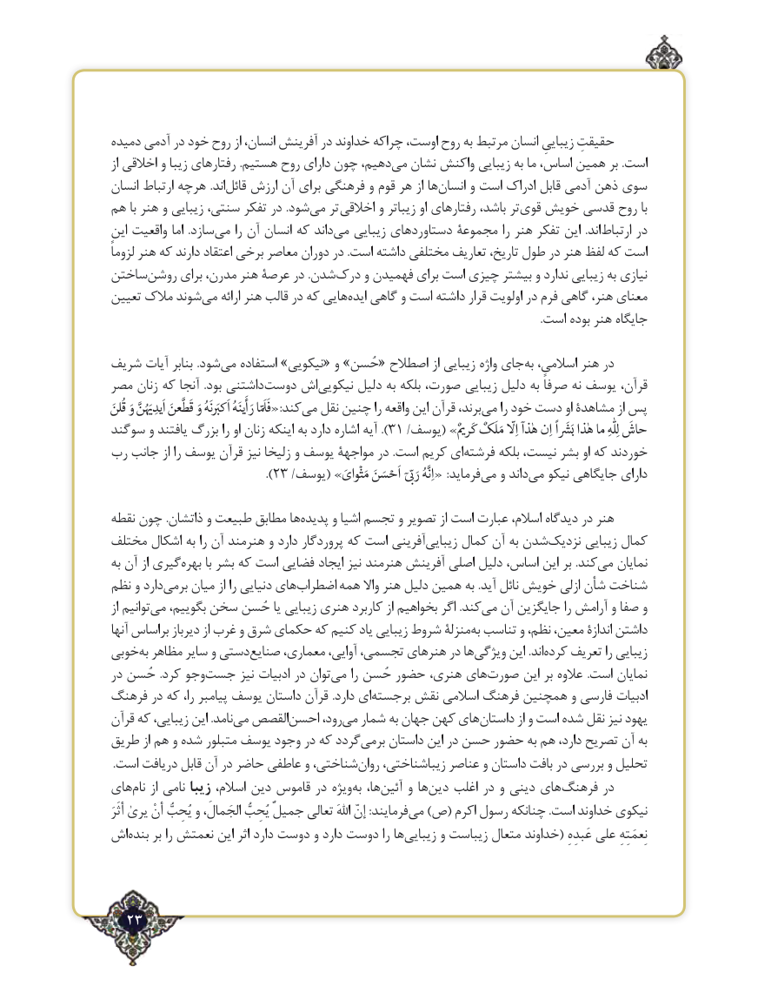

# PDF page 23

دمیده آدمی در خود روح از انسان، آفرینش در خداوند چراکه اوست، روح به مرتبط انسان زیباییِ حقیقتِ
از اخالقی و زیبا رفتارهای .هستیم روح دارای چون دهیم،می‌  نشان واکنش زیبایی به ما اساس، همین بر .است
انسان ارتباط هرچه .اندقائل‌   ارزش آن برای فرهنگی و قوم هر از هاانسان‌     و است ادراک ‌قابل آدمی ذهن سوی
هم با هنر و زیبایی سنتی، تفکر در .شودمی‌   تر اخالقی و زیباتر او رفتارهای باشد، ترقوی‌  خویش قدسی روح با
این واقعیت اما  .سازدمی‌    را آن انسان که داندمی‌   زیبایی دستاوردهای مجموعة را هنر تفکر این  .اندارتباط‌     در
لزوماً هنر که دارند اعتقاد برخی معاصر دوران در .است داشته مختلفی تعاریف تاریخ، طول در هنر لفظ که است
ساختنروشن‌     برای مدرن، هنر عرصة در .شدندرک‌    و فهمیدن برای است چیزی بیشتر و ندارد زیبایی به نیازی
تعیین مالک شوندمی‌    ارائه هنر قالب در که هاییایده‌   گاهی و است داشته قرار اولویت در فرم گاهی هنر، معنای
                                                                                                                                                           .است بوده هنر جایگاه

شریف آیات بنابر .شودمی‌   استفاده »نیکویی« و »حُسن« اصطالح از زیبایی واژه جایبه‌  اسالمی، هنر در
مصر زنان که آنجا .بود داشتنیدوست‌    اشنیکویی‌      دلیل به بلکه صورت، زیبایی دلیل به صرفاً نه یوسف قرآن،
قُلنَ وَ َُنَّ اَیدِ قَطَّعنَ وَ َنَهُ اَک رَأَینَهُ فَلَّا:«کندمی‌  نقل چنین را واقعه این قرآن برند،می‌    را خود دست او مشاهدة از پس
سوگند و یافتند بزرگ را او زنان اینکه به دارد اشاره آیه ). 31 /یوسف( »ٌ کَر مَلَکٌ اِلّهٰذا اِن َاً‚بَ هٰذا ما  لِلّٰهِ حاشَ
رب جانب از را یوسف قرآن نیز زلیخا و یوسف مواجهة در .است کریم ایفرشته‌      بلکه نیست، بشر او که خوردند
                                 ‌.)23 /یوسف( »مَثْوایَ اَحْسَنَ  Œّفرماید‌رَ  اِنَّهُ« :    می و داندمی‌   نیکو جایگاهی دارای
نقطه چون .ذاتشان و طبیعت مطابق هاپدیده‌     و اشیا تجسم و تصویر از است عبارت اسالم، دیدگاه در هنر
مختلف اشکال به را آن هنرمند و دارد پروردگار که است آفرینیزیبایی‌     کمال آن به شدننزدیک‌      زیبایی کمال
به آن از گیریبهره‌      با بشر که است فضایی ایجاد نیز هنرمند آفرینش اصلی دلیل اساس، این بر .کندمی‌   نمایان
نظم و داردبرمی‌    میان از را دنیایی هایاضطراب‌     همه واال هنر دلیل همین به .آید نائل خویش ازلی شأن شناخت
از توانیممی‌   بگوییم، سخن حُسن یا زیبایی هنری کاربرد از بخواهیم اگر .کندمی‌  آن جایگزین را آرامش و صفا و
آنها براساس دیرباز از غرب و شرق حکمای که کنیم یاد زیبایی شروط منزلةبه‌ تناسب و نظم، معین، اندازة داشتن
خوبیبه‌ مظاهر سایر و دستیصنایع‌     معماری، آوایی، تجسمی، هنرهای در هاویژگی‌      این .اندکرده‌    تعریف را زیبایی
در حُسن .کرد وجوجست‌      نیز ادبیات در توانمی‌    را حُسن حضور هنری، هایصورت‌      این بر عالوه .است نمایان
فرهنگ در که را، پیامبر یوسف داستان قرآن .دارد ایبرجسته‌     نقش اسالمی فرهنگ همچنین و فارسی ادبیات
قرآن که زیبایی، این .نامدمی‌  القصصاحسن‌      رود،می‌  شمار به جهان کهن هایداستان‌         از و است شده ‌نقل نیز یهود
طریق از هم و شده متبلور یوسف وجود در که گرددبرمی‌    داستان این در حسن حضور به هم دارد، تصریح آن به
.‌است دریافت قابل آن در حاضر عاطفی و شناختی،روان زیباشناختی، عناصر و داستان بافت در بررسی و تحلیل
هاینام‌    از نامی زیبا اسالم، دین قاموس در ویژهبه‌  ها،آئین‌    و هادین‌   اغلب در و دینی هایفرهنگ‌      در
أثَرَ یرىٰ أنْ یُحِبُّ و الجَمالَ، یُحِبُّ جمیلٌ تعالى اهللَ إنّ :فرمایندمی‌   )ص( اکرم رسول چنانکه .است خداوند نیکوی
اشبنده‌    بر را نعمتش این اثر دارد دوست و دارد دوست را هازیبایی‌      و زیباست متعال خداوند( عَبدِهِ على نِعمَتِهِ

  23٢

