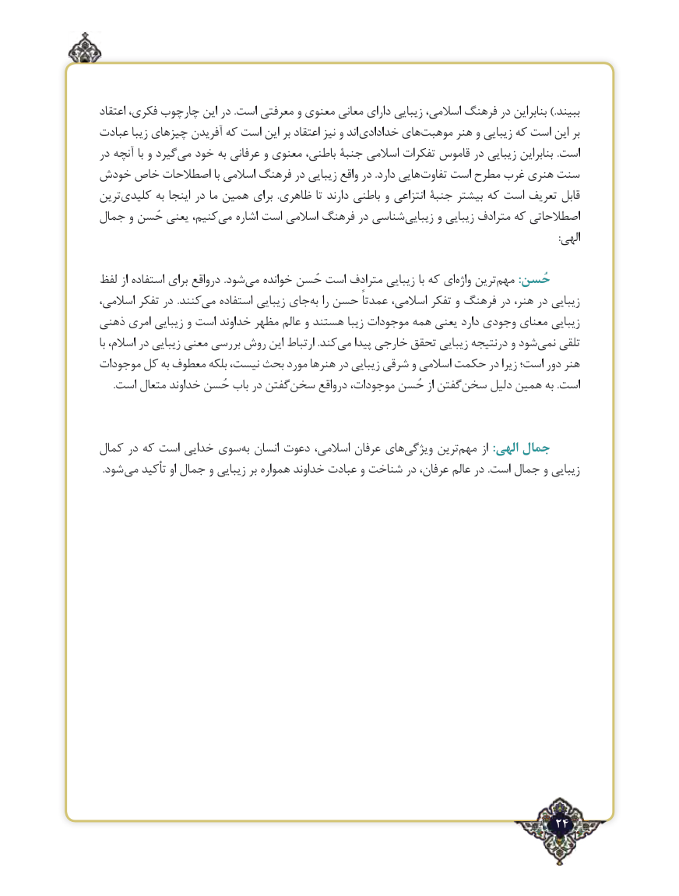

# PDF page 24

اعتقاد فکری، چارچوب این در .است معرفتی و معنوی معانی دارای زیبایی اسالمی، فرهنگ در بنابراین .)ببیند
عبادت زیبا چیزهای آفریدن که است این بر اعتقاد نیز و اند خدادادی هایموهبت‌      هنر و زیبایی که است این بر
در آنچه با و گیردمی‌  خود به عرفانی و معنوی باطنی، جنبة اسالمی تفکرات قاموس در زیبایی بنابراین .است
خودش خاص اصطالحات با اسالمی فرهنگ در زیبایی واقع در .دارد هاییتفاوت‌    است مطرح غرب هنری سنت
ترینکلیدی‌       به اینجا در ما همین برای  .ظاهری تا دارند باطنی و انتزاعی جنبة بیشتر که است تعریف قابل
جمال و حُسن یعنی کنیم،می‌   اشاره است اسالمی فرهنگ در شناسیزیبایی‌      و زیبایی مترادف که اصطالحاتی
                                                                                                                                                                                         :الهی

لفظ از استفاده برای درواقع .شودمی‌   خوانده حُسن است مترادف زیبایی با که ایواژه‌   ترینمهم‌      :حُسن
اسالمی، تفکر در .کنندمی‌   استفاده زیبایی جایبه‌  را حسن عمدتاً اسالمی، تفکر و فرهنگ در هنر، در زیبایی
ذهنی امری زیبایی و است خداوند مظهر عالم و هستند زیبا موجودات همه یعنی دارد وجودی معنای زیبایی
با اسالم، در زیبایی معنی بررسی روش این ارتباط .کندمی‌   پیدا خارجی تحقق زیبایی درنتیجه و شودنمی‌   تلقی
موجودات کل به معطوف بلکه نیست، بحث مورد هنرها در زیبایی شرقی و اسالمی حکمت در زیرا است؛ دور هنر
.‌است متعال خداوند حُسن باب در گفتنسخن درواقع موجودات، حُسن از گفتنسخن‌     دلیل همین به .است

کمال در که است خدایی سویبه‌  انسان دعوت اسالمی، عرفان هایویژگی‌     ترینمهم‌     از :الهی جمال
. شود می تأکید او جمال و زیبایی بر همواره خداوند عبادت و شناخت در عرفان، عالم در .است جمال و زیبایی

                                                                  24٢

