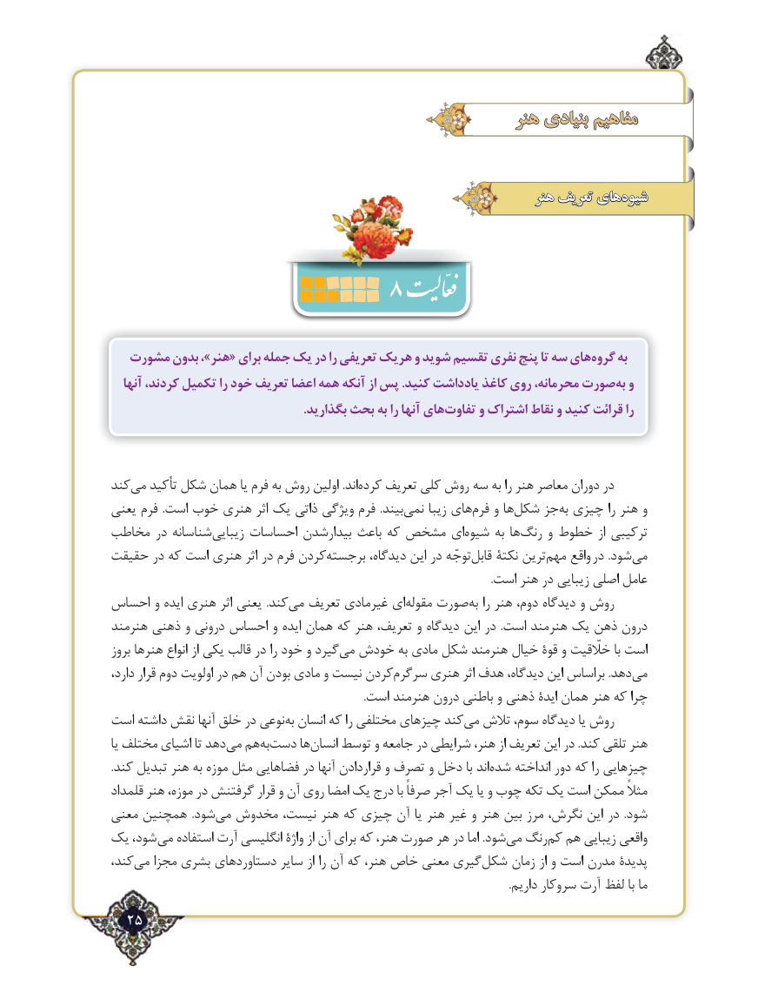

# PDF page 25

هنر بنیادی مفاهیم

                                                                   هنر تعریف های ‌شیوه
                      8
  مشورت بدون ،»هنر« برای جمله یک در را تعریفی هریک و شوید تقسیم نفری‌پنج تا سه هایگروه‌    به
  آنها کردند، تکمیل را خود تعریف اعضا همه آنکه از پس .کنید یادداشت کاغذ روی محرمانه، صورتبه‌  و
   .‌بگذارید بحث به را آنها هایتفاوت و اشتراک نقاط و کنید قرائت را

کندمی‌   تأکید شکل همان یا فرم به روش اولین .اندکرده‌    تعریف کلی روش سه به را هنر معاصر دوران در
یعنی فرم  .است خوب هنری اثر یک ذاتی ویژگی فرم  .بیندنمی‌     زیبا هایفرم‌   و هاشکل‌   جزبه‌ چیزی را هنر و
مخاطب در شناسانهزیبایی‌     احساسات بیدارشدن باعث که مشخص ایشیوه‌     به هارنگ‌    و خطوط از ترکیبی
حقیقت در که است هنری اثر در فرم کردنبرجسته‌       دیدگاه، این در توجّهقابل‌    نکتة ترینمهم‌    واقع در .شودمی‌
                                                                                                                                         .است هنر در زیبایی اصلی عامل
احساس و ایده هنری اثر یعنی .کندمی‌  تعریف غیرمادی ایمقوله‌   صورتبه‌  را هنر دوم، دیدگاه و روش
هنرمند ذهنی و درونی احساس و ایده همان که هنر تعریف، و دیدگاه این در  .است هنرمند یک ذهن درون
بروز هنرها انواع از یکی قالب در را خود و گیردمی‌  خودش به مادی شکل هنرمند خیال قوة و خلّقیت با است
دارد، قرار دوم اولویت در هم آن‌  بودن‌مادی و نیست کردنسرگرم‌     هنری اثر هدف دیدگاه، این براساس .دهدمی‌
                                                                                           .است هنرمند درون باطنی و ذهنی ایدۀ همان هنر که چرا
است داشته نقش آنها خلق در نوعیبه‌  انسان که را مختلفی چیزهای کندمی‌  تالش سوم، دیدگاه یا روش
یا مختلف اشیای تا دهدمی‌  همبه‌ دست‌     هاانسان‌    توسط و جامعه در شرایطی هنر، از تعریف این در .کند تلقی هنر
.کند تبدیل هنر به موزه مثل فضاهایی در آنها قراردادن و تصرف و دخل با اندشده‌    انداخته‌      دور که را چیزهایی
قلمداد هنر موزه، در گرفتنش قرار و آن روی امضا یک درج با صرفاً آجر یک یا و چوب تکه یک است ممکن مثالً
معنی همچنین  .شودمی‌  مخدوش نیست، هنر که چیزی آن یا هنر غیر و هنر بین مرز نگرش، این در  .شود
یک شود، می استفاده آرت انگلیسی واژۀ از آن برای که هنر، صورت هر در اما .شودمی‌  رنگکم‌  هم زیبایی واقعی
کند،می‌   مجزا بشری دستاوردهای سایر از را آن که هنر، خاص معنی گیریشکل‌    زمان از و است مدرن پدیدة
                                                                                                                                                .داریم سروکار آرت لفظ با ما
  25٢

