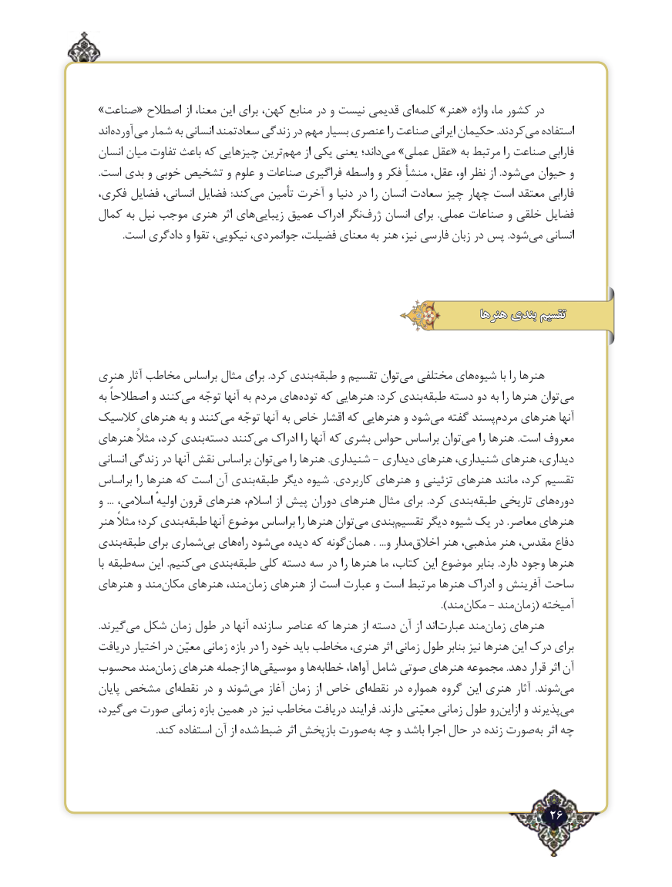

# PDF page 26

»صناعت« اصطالح از معنا، این برای کهن، منابع در و نیست قدیمی ایکلمه‌   »هنر« واژه ما، کشور در
اند آورده می شمار به انسانی سعادتمند زندگی در مهم بسیار عنصری را صناعت ایرانی حکیمان .کردندمی‌   استفاده
انسان میان تفاوت باعث که چیزهایی ترینمهم‌     از یکی یعنی داند؛می‌  »عملی عقل« به مرتبط را صناعت فارابی
.است بدی و خوبی تشخیص و علوم و صناعات فراگیری واسطه و فکر منشأِ عقل، او، نظر از .شودمی‌  حیوان و
فکری، فضایل انسانی، فضایل  :کندمی‌   تأمین آخرت و دنیا در را انسان سعادت چیز چهار است معتقد فارابی
کمال به نیل موجب هنری اثر هایزیبایی‌    عمیق ادراک نگرژرف‌    انسان برای  .عملی صناعات و خلقی فضایل
          .است دادگری و تقوا نیکویی، جوانمردی، فضیلت، معنای به هنر نیز، فارسی زبان در پس .شودمی‌   انسانی

                                                                     هنرها بندی تقسیم

هنری آثار مخاطب براساس مثال‌برای .کرد بندیطبقه‌     و تقسیم توانمی‌  مختلفی هایشیوه‌       با را هنرها
به اصطالحاً و کنندمی‌   توجّه آنها به مردم هایتوده‌   که هنرهایی :کرد بندیطبقه‌    دسته دو به را هنرها توان می
کالسیک هنرهای به و کنندمی‌   توجّه آنها به خاص اقشار که هنرهایی و شودمی‌   گفته پسندمردم‌    هنرهای آنها
هنرهای مثالً کرد، بندیدسته‌    کنندمی‌   ادراک را آنها که بشری حواس براساس توانمی‌    را هنرها .است معروف
انسانی زندگی در آنها نقش براساس توانمی‌    را هنرها .شنیداری - دیداری هنرهای شنیداری، هنرهای دیداری،
براساس را هنرها که است آن بندیطبقه‌    دیگر شیوه  .کاربردی هنرهای و تزئینی هنرهای مانند کرد، تقسیم
و  ... اسالمی، اولیهٔ قرون هنرهای اسالم، از پیش دوران هنرهای مثال برای‌        .کرد بندیطبقه‌    تاریخی هایدوره‌
هنر مثالً کرد؛ بندیطبقه‌      آنها موضوع براساس را هنرها توانمی‌  بندیتقسیم‌     دیگر شیوه یک در .معاصر هنرهای
بندیطبقه‌     برای شماریبی‌  هایراه‌  شودمی‌   دیده که گونههمان‌          . ...و مداراخالق‌     هنر مذهبی، هنر مقدس، دفاع
با طبقهسه‌   این .کنیممی‌  بندیطبقه‌    کلی دسته سه در را هنرها ما کتاب، این موضوع بنابر .دارد وجود هنرها
هنرهای و مندمکان‌    هنرهای مند،زمان‌    هنرهای از است عبارت و است مرتبط هنرها ادراک و آفرینش ساحت
                                                                                                         ).مندمکان‌    - مندزمان‌    ( آمیخته
.گیرندمی‌  شکل زمان طول در آنها سازنده عناصر که هنرها از دسته آن از اندعبارت‌     مندزمان‌    هنرهای
دریافت اختیار در معیّن زمانی بازه در را خود باید مخاطب هنری، اثر زمانی طول بنابر نیز هنرها این درک برای
محسوب مندزمان‌   هنرهای ازجمله هاموسیقی‌       و هاخطابه‌       آواها، شامل صوتی هنرهای مجموعه .دهد قرار اثر آن
پایان مشخص اینقطه‌    در و شوندمی‌    آغاز زمان از خاص اینقطه‌    در همواره گروه این هنری آثار  .شوندمی‌
گیرد،می‌  صورت زمانی بازه همین در نیز مخاطب دریافت فرایند .دارند معیّنی زمانی طول روازاین‌    و پذیرندمی‌
                       .کند استفاده آن از شدهضبط‌      اثر بازپخش صورتبه‌ چه و باشد اجرا حال در زنده صورتبه‌  اثر چه

                                                                   26٢

