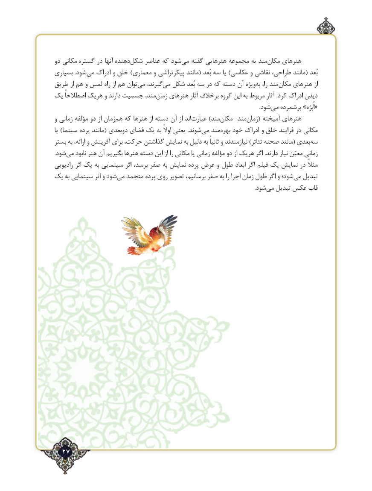

# PDF page 27

دو مکانی گستره در آنها دهندهشکل‌    عناصر که شودمی‌   گفته هنرهایی مجموعه به مندمکان‌    هنرهای
بسیاری .شودمی‌   ادراک و خلق )معماری و پیکرتراشی مانند( بُعد سه یا )عکاسی و نقاشی طراحی، مانند( بُعد
طریق از هم و لمس راه از هم توانمی‌   گیرند،می‌  شکل بُعد سه در که دسته آن ویژهبه‌  را، مندمکان‌    هنرهای از
یک اصطالحاً هریک و دارند جسمیت مند،زمان‌   هنرهای آثار برخالف گروه این به مربوط آثار .کرد ادراک دیدن
          .‌«شودمی برشمرده »اُبژه
و زمانی مؤلفه دو از زمانهم‌  که هنرها از دسته آن از اندعبارت‌       )مندمکان‌       ‌-‌مندزمان‌    ( آمیخته هنرهای
یا )سینما پرده مانند( دوبعدی فضای یک به اوالً یعنی .شوندمی‌   مندبهره‌   خود ادراک و خلق فرایند در مکانی
بستر به ارائه، و آفرینش برای حرکت، گذاشتن نمایش به دلیل به ثانیاً و نیازمندند )تئاتر صحنه مانند( بعدیسه‌
.شودمی‌   نابود هنر آن بگیریم هنرها دسته این از را مکانی یا زمانی مؤلفه دو از هریک اگر .دارند نیاز معیّن زمانی
رادیویی اثر یک به سینمایی اثر برسد، صفر به نمایش پرده عرض و طول ابعاد اگر فیلم یک نمایش در مثالً
یک به سینمایی اثر و شودمی‌  منجمد پرده روی تصویر برسانیم، صفر به را اجرا زمان طول اگر و شود؛می‌  تبدیل
                             .‌شودمی تبدیل عکس قاب

  27٢

