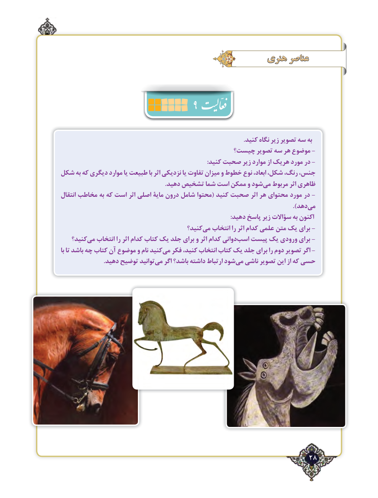

# PDF page 28

هنری عناصر
                                   9
                                                                                                                     .کنید نگاه زیر تصویر سه به
                                        چيست؟ تصویر سه هر موضوع -
                                                                                              :کنید صحبت زير موارد از هریک مورد در -
شکل به که دیگری موارد یا طبیعت با اثر نزدیکی یا تفاوت میزان و خطوط نوع ابعاد، شکل، رنگ، جنس،
  .‌دهید تشخیص شما است ممکن و شودمی مربوط اثر ظاهری
انتقال مخاطب به که است اثر اصلی مایۀ درون شامل محتوا( کنید صحبت اثر هر محتوای مورد در -
                                                                                                                      .)دهدمی‌
                                                                                                             :دهید پاسخ زیر سؤاالت به اکنون
                                         کنید؟می‌   انتخاب را اثر کدام علمی متن یک برای -
   کنید؟می‌   انتخاب را اثر کدام کتاب یک جلد برای و اثر کدام دوانیاسب‌   پیست یک ورودی برای -
با تا باشد چه کتاب آن موضوع و نام کنیدمی‌  فکر کنید، انتخاب کتاب یک جلد برای را دوم تصویر اگر -
                           .دهید توضیح توانیدمی‌   اگر باشد؟ داشته ارتباط شودمی‌  ناشی تصویر این از که حسی

                                                            28٢

