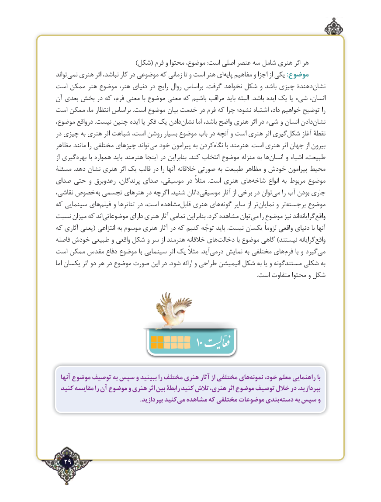

# PDF page 29

)شكل( فرم و محتوا موضوع، :است اصلي عنصر سه شامل هنري اثر هر
تواندنمی‌   هنری اثر نباشد، کار در موضوعی که زمانی تا و است هنر ایپایه‌   مفاهیم و اجزا از یکی :موضوع
است ممکن هنر موضوع هنر، دنیای در رایج روال براساس  .گرفت نخواهد شکل و باشد چیزی دهندةنشان‌
آن بعدی بخش در که فرم، معنی با موضوع معنی که باشیم مراقب باید البته  .باشد ایده یک یا ءشی‌    انسان،
است ممکن ما، انتظار براساس .است موضوع بیان خدمت در فرم که چرا نشود؛ اشتباه داد، خواهیم توضیح را
موضوع، درواقع .نیست چنین ایده یا فکر یک دادننشان‌      اما باشد، واضح هنری اثر در ءشی‌   و انسان دادننشان‌
در چیزی به هنری اثر شباهت است، روشن بسیار موضوع باب در آنچه و است هنری اثر گیریشکل‌     آغاز نقطة
مظاهر مانند را مختلفی چیزهای تواندمی‌  خود پیرامون به کردننگاه‌     با هنرمند .است هنری اثر جهان از بیرون
از گیریبهره‌      با همواره باید هنرمند اینجا در بنابراین  .کند انتخاب موضوع منزله ‌ به هاانسان‌     و اشیاء طبیعت،
مسئلة  .دهد نشان هنری اثر یک قالب در را آنها خالقانه صورتی به طبیعت مظاهر و خودش پیرامون محیط
صدای حتی و رعدوبرق پرندگان، صدای موسیقی، در مثالً  .است هنری هایشاخه‌       انواع به مربوط موضوع
نقاشی، خصوصبه‌ تجسمی هنرهای در اگرچه .شنید دانانموسیقی‌          آثار از برخی در توانمی‌    را آب بودن‌جاری
که سینمایی هایفیلم‌    و تئاترها در است، مشاهدهقابل‌   هنری هایگونه‌    سایر از ترنمایان‌      و تربرجسته‌      موضوع
نسبت میزان که اندموضوعاتی‌         دارای هنری آثار تمامی بنابراین .کرد مشاهده توانمی‌    را موضوع نیز اندگرایانه‌     واقع‌
که آثاری یعنی( انتزاعی به موسوم هنری آثار در که کنیم توجّه باید .نیست یکسان لزوماً واقعی دنیای با آنها
فاصله خودش طبیعی و واقعی شکل و سر از هنرمند خالقانه هایدخالت‌          با موضوع گاهی )نیستند گرایانهواقع‌
است ممکن مقدس دفاع موضوع با سینمایی اثر یک مثالً .آیددرمی‌    نمایش به مختلفی هایفرم‌     با و گیردمی‌
اما یکسان اثر دو هر در موضوع صورت این در .شود ارائه و طراحی انیمیشن شکل به یا و مستندگونه شکلی به
                                                                                                                                                 .است متفاوت محتوا و شکل

                                            10
  آنها موضوع توصیف به سپس و ببینید را مختلف هنری آثار از مختلفی هاینمونه‌    خود، معلم راهنمایی با
  کنید مقایسه را آن موضوع و هنری اثر بین رابطة کنید تالش هنری، اثر موضوع توصیف خالل در .بپردازید
    .‌بپردازید کنیدمی مشاهده که مختلفی موضوعات بندیدسته‌     به سپس و

  29٢

