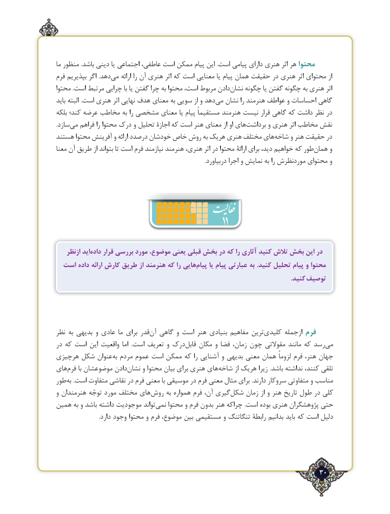

# PDF page 30

ما منظور .باشد دینی یا اجتماعی عاطفی، است ممکن پیام این .است پیامی دارای هنری اثر هر محتوا
فرم بپذیریم اگر .دهدمی‌    ارائه را آن هنری اثر که است معنایی یا پیام همان حقیقت در هنری اثر محتوای از
محتوا .است مرتبط چرایی با یا گفتن چرا به محتوا است، مربوط دادننشان‌    چگونه یا گفتن چگونه به هنری اثر
باید البته .است هنری اثر نهایی هدف معنای به سویی از و دهدمی‌  نشان را هنرمند عواطف و احساسات گاهی
بلکه کند؛ عرضه مخاطب به را مشخصی معنای یا پیام مستقیماً هنرمند نیست قرار گاهی که داشت نظر در
.سازدمی‌   فراهم را محتوا درک و تحلیل اجازة که است هنر معنای از او هایبرداشت‌       و هنری اثر مخاطب نقش
هستند محتوا آفرینش و ارائه درصدد خودشان خاص روش به هریک هنری مختلف هایشاخه‌     و هنر حقیقت در
معنا آن طریق از بتواند تا است فرم نیازمند هنرمند هنری، اثر در محتوا ارائة برای دید، خواهیم که طورهمان‌     و
                                                                                                        .دربیاورد اجرا و نمایش به را موردنظرش محتوای و

                                                       11
    ازنظر ایدداده‌    قرار بررسی مورد موضوع، یعنی قبلی بخش در که را آثاری کنید تالش بخش این در
  است داده ارائه کارش طریق از هنرمند که را هاییپیام‌     یا پیام عبارتی به .کنید تحلیل پیام و محتوا
                                                                                                                                                 .کنید توصیف

نظر به بدیهی و عادی ما برای قدر‌آن گاهی و است هنر بنیادی مفاهیم ترین‌کلیدی ازجمله فرم
در که است این واقعیت اما  .است تعریف و درک‌قابل مکان و فضا زمان، چون مقوالتی مانند که رسد ‌می
هرچیزی شکل عنوانبه‌  مردم عموم است ممکن که را آشنایی و بدیهی معنی همان لزوماً فرم هنر، جهان
های‌فرم با موضوعشان دادننشان‌     و محتوا بیان برای هنری های‌شاخه از هریک زیرا .باشد نداشته کنند، تلقی
طور‌به .است متفاوت نقاشی در فرم معنی با موسیقی در فرم معنی مثال برای .دارند سروکار متفاوتی و مناسب
و هنرمندان توجّه مورد مختلف های‌روش به همواره فرم آن، گیریشکل‌    زمان از و هنر تاریخ طول در کلی
همین به و باشد داشته موجودیت تواند‌نمی محتوا و فرم بدون هنر چراکه .است بوده هنری پژوهشگران حتی
                              .دارد وجود محتوا و فرم موضوع، بین مستقیمی و تنگاتنگ رابطة بدانیم باید که است دلیل

                                                                       30٢

