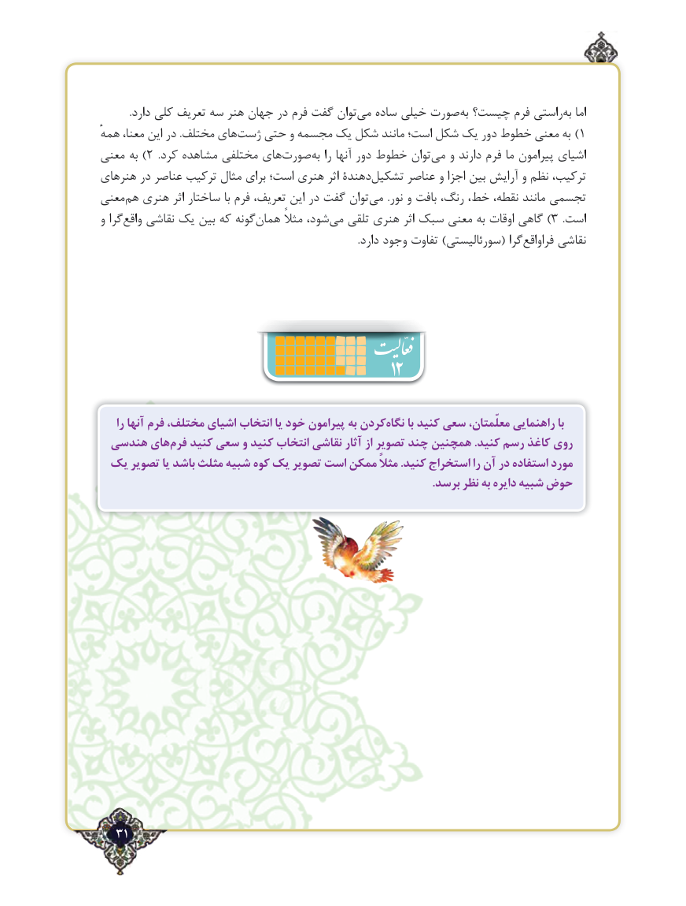

# PDF page 31

.دارد کلی تعریف سه هنر جهان در فرم گفت توان‌می ساده خیلی صورت ‌به چیست؟ فرم راستیبه‌  اما
همهٔ معنا، این در .مختلف های‌ژست حتی و مجسمه یک شکل مانند است؛ شکل یک دور خطوط معنی به  )1
معنی به )2  .کرد مشاهده مختلفی های‌صورت‌به را آنها دور خطوط توان‌می و دارند فرم ما پیرامون اشیای
هنرهای در عناصر ترکیب مثال برای است؛ هنری اثر دهندةتشکیل‌      عناصر و اجزا بین آرایش و نظم ترکیب،
معنی‌هم هنری اثر ساختار با فرم تعریف، این در گفت توان‌می  .نور و بافت رنگ، خط، نقطه، مانند تجسمی
و گراواقع‌   نقاشی یک بین که گونههمان‌       مثالً شود،‌3)می تلقی هنری اثر سبک معنی به اوقات گاهی        .است
   .‌دارد وجود تفاوت )سورئالیستی( گرافراواقع نقاشی

                                             12
    را آنها فرم مختلف، اشیای انتخاب یا خود پیرامون به کردننگاه‌      با کنید سعی معلّمتان، راهنمایی با
 هندسی هایفرم‌   کنید سعی و کنید انتخاب نقاشی آثار از تصویر چند همچنین .کنید رسم کاغذ روی
 یک تصویر یا باشد مثلث شبیه کوه یک تصویر است ممکن مثالً .کنید استخراج را آن در استفاده مورد
                                                                                                                     .برسد نظر به دایره شبیه حوض

  31٢

