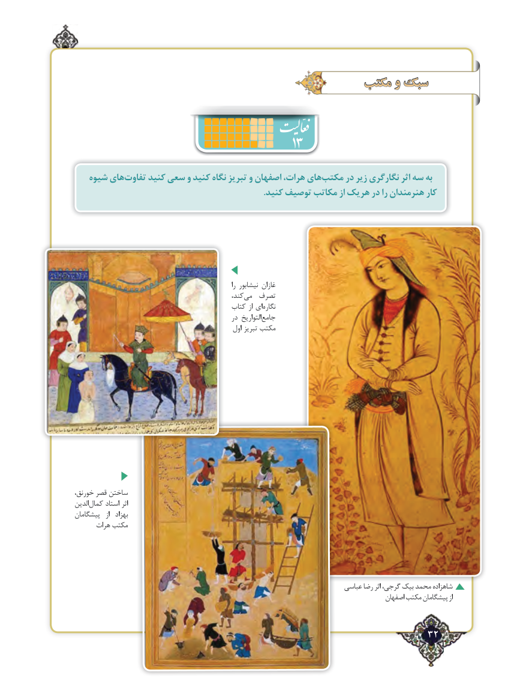

# PDF page 32

مکتب و سبک
                                      13
   شیوه هایتفاوت‌     کنید سعی و کنید نگاه تبریز و اصفهان هرات، هایمکتب‌     در زیر نگارگری اثر سه به
                                                                                       .کنید توصیف مکاتب از هریک در را هنرمندان کار

                                                                           را نیشابور غازان
                                                   کند، ‌می  تصرف
                                            کتاب از ای ‌نگاره
                                                  در التواریخ‌جامع
                                                    اول تبریز مکتب

،ساختنخورنق قصر
الدینکمال‌     استاد اثر
پیشگامان   از  بهزاد
      هرات مکتب

                                                                           عباسی رضا اثر گرجی، بیک محمد شاهزاده
                                                                                                اصفهان مکتب پیشگامان از

                                                              32٢

