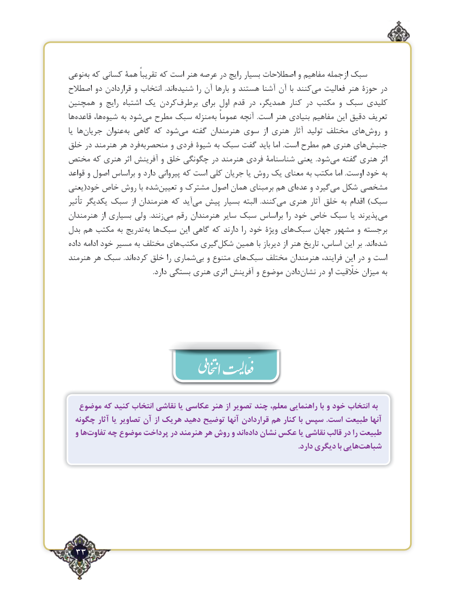

# PDF page 33

نوعیبه‌ که کسانی همة تقریباً که است هنر عرصه در رایج بسیار اصطالحات و مفاهیم ازجمله سبک
اصطالح دو قراردادن و انتخاب  .اند‌شنیده را آن بارها و هستند آشنا آن با کنندمی‌   فعالیت هنر حوزة در
همچنین و رایج اشتباه یک کردنبرطرف‌       برای اول قدم در همدیگر، کنار در مکتب و سبک کلیدی
ها‌قاعده ها،‌شیوه به شود‌می مطرح سبک منزلهبه‌  عموماً آنچه  .است هنر بنیادی مفاهیم این دقیق تعریف
یا ها‌جریان عنوانبه‌  گاهی که شود‌می گفته هنرمندان سوی  از هنری آثار تولید مختلف های‌روش و
خلق در هنرمند هر فرد ‌منحصربه و فردی شیوة به سبک گفت باید اما  .است مطرح هم هنری های‌جنبش
مختص که هنری اثر آفرینش و خلق چگونگی در هنرمند فردی شناسنامة یعنی  .شود ‌می گفته هنری اثر
قواعد و اصول براساس و دارد پیروانی که است کلی جریان یا روش یک معنای به مکتب اما .اوست خود به
یعنی(خود خاص روش با شده‌تعیین و مشترک اصول همان برمبنای هم ای‌عده و گیردمی‌  شکل مشخصی
تأثیر یکدیگر سبک از هنرمندان که آید ‌می پیش بسیار البته  .کنندمی‌  هنری آثار خلق به اقدام )سبک
هنرمندان از بسیاری ولی  .زنندمی‌   رقم هنرمندان سایر سبک براساس را خود خاص سبک یا پذیرندمی‌
بدل هم مکتب به تدریج ‌به ها‌سبک این گاهی که دارند را خود ویژة های‌سبک جهان مشهور و برجسته
داده ادامه خود مسیر به مختلف های‌مکتب گیری ‌شکل همین با دیرباز از هنر تاریخ اساس، این بر  .اند ‌شده
هنرمند هر سبک  .اندکرده‌   خلق را شماری‌بی و متنوع های‌سبک مختلف هنرمندان فرایند، این در و است
                                                   .دارد بستگی هنری اثری آفرینش و موضوع دادن‌    در او خلّقیت میزان به             نشانّ

  موضوع که کنید انتخاب نقاشی یا عکاسی هنر از تصویر چند معلم، راهنمایی با و خود انتخاب به
  چگونه آثار یا تصاویر آن از هریک دهید توضیح آنها قراردادن‌      هم کنار با سپس .است طبیعت آنها
  و هاتفاوت‌    چه موضوع پرداخت در هنرمند هر روش و اندداده‌   نشان عکس یا نقاشی قالب در را طبیعت
       .‌دارد دیگری با هاییشباهت

 33٢

