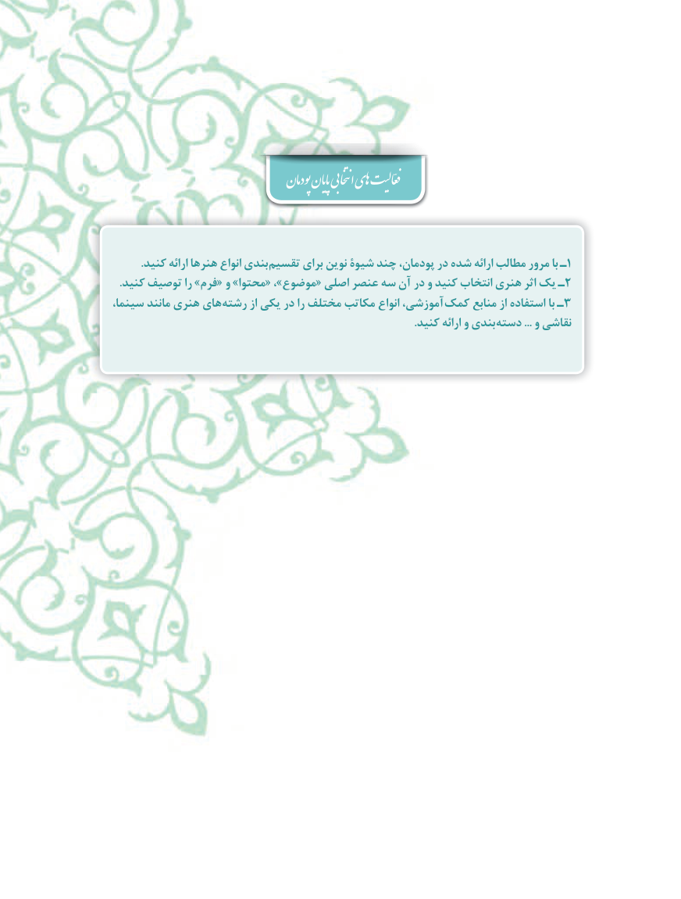

# PDF page 34

پودمان پایان انتخابی اهی  فعّالیت

          .کنید ارائه هنرها انواع بندی تقسیم برای نوین شیوۀ چند پودمان، در شده ارائه مطالب مرور با ـ1
  .کنید توصیف را »فرم« و »محتوا« ،»موضوع« اصلی عنصر سه آن در و کنید انتخاب هنری اثر یک ـ2
،هایسینما مانند هنری        رشته از یکی در را مختلف مکاتب انواع آموزشی، کمک منابع از استفاده با ـ3
                                                                                                           .کنید ارائه و بندی دسته ... و نقاشی

                                                           34٢

