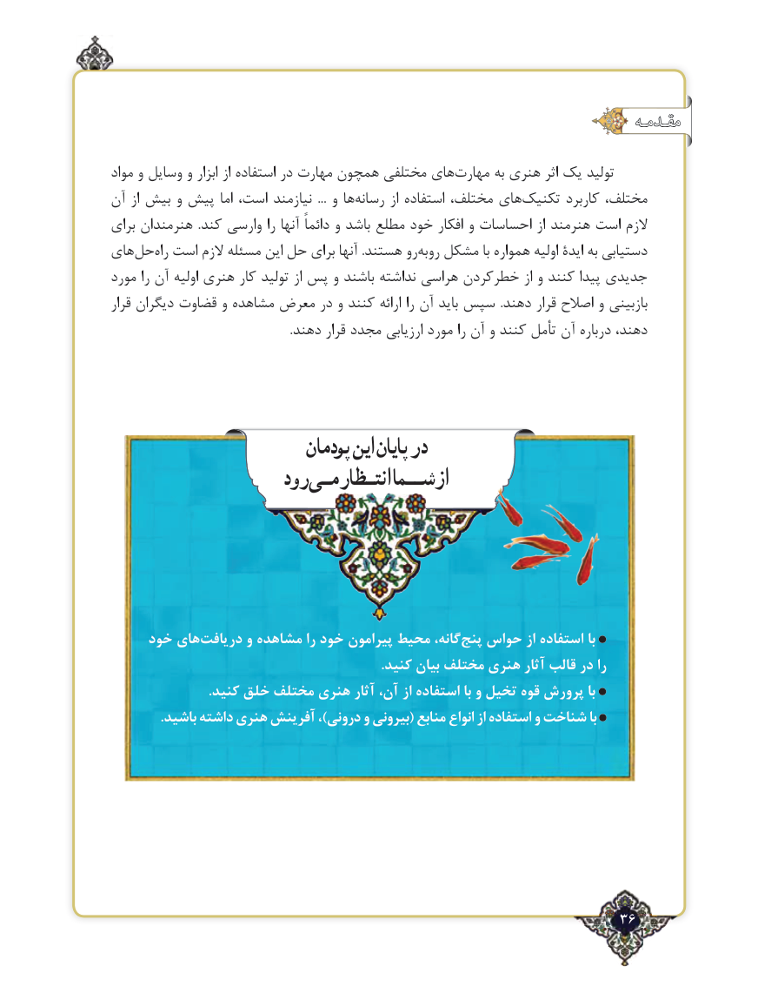

# PDF page 36

مقـدمـه

مواد و وسایل و ابزار از استفاده در مهارت همچون مختلفی های‌مهارت به هنری اثر یك تولید
آن از بیش و پیش اما است، نیازمند  ... و ها ‌رسانه از استفاده ،های‌مختلف      ‌تکنیک كاربرد ،مختلف
برای هنرمندان  .کند وارسی را آنها دائماً و باشد مطلع خود افكار و احساسات از هنرمند است الزم
های ‌حلراه‌  است الزم مسئله این حل برای آنها .هستند روروبه‌  مشكل با همواره اولیه ایدۀ به دستیابی
مورد را آن اولیه هنری كار تولید از پس و باشند نداشته هراسی كردنخطر‌      از و كنند پیدا جدیدی
قرار دیگران قضاوت و مشاهده معرض در و کنند ارائه را آن باید سپس  .دهند قرار اصالح و بازبینی
                                                            .دهند قرار مجدد ارزیابی مورد را آن و کنند تأمل آن درباره دهند،

                          پودمان اینپایان در
                    رود انتـظارمـیشــمااز

     خود های‌دریافت و مشاهده را خود پیرامون محیط گانه، ‌پنج حواس از استفاده با
                                                                               .كنید بیان مختلف هنری آثار قالب در را
                             .کنید خلق مختلف هنری آثار‌،آن از استفاده با و تخیل قوه پرورش با
               .باشید داشته هنری آفرینش ،)درونی و بیرونی( منابع انواع از استفاده و شناخت با

                                                              36٢

