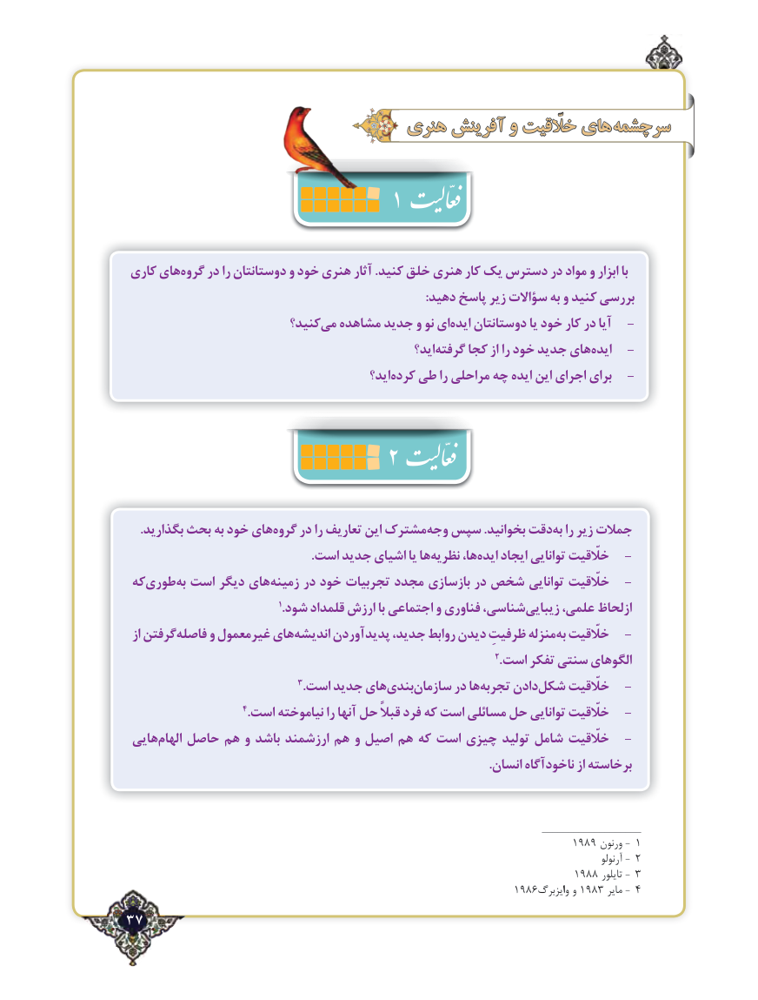

# PDF page 37

هنری آفرینش و خلّقیت های سرچشمه
                                            1
 كاری هایگروه‌    در را دوستانتان و خود هنری آثار .كنید خلق هنری كار یك دسترس در مواد و ابزار با
                                                                                                :دهید پاسخ زیر سؤاالت به و کنید بررسی
                          كنید؟می‌  مشاهده جدید و نو ایایده‌   دوستانتان یا خود كار در آیا   -
                                                      اید؟گرفته‌    كجا از را خود جدید هایایده‌        -
                                              اید؟کرده‌   طی را مراحلی چه ایده این اجرای برای   -
                               2

    .بگذارید بحث به خود هایگروه‌    در را تعاریف این مشترکوجه‌  سپس .بخوانید دقتبه‌  را زیر جمالت
                                                           .است جدید اشیای یا هانظریه‌      ها،ایده‌    ایجاد توانایی خلّقیت   -
 کهطوری‌     به‌ است دیگر هایزمینه‌     در خود تجربیات مجدد بازسازی در شخص توانایی خلّقیت   -
                                                    1.شود قلمداد ارزش با اجتماعی و فناوری شناسی،زیبایی‌     علمی، ازلحاظ
 از گرفتنفاصله‌     و غیرمعمول هایاندیشه‌     پدیدآوردن جدید، روابط دیدن ظرفیتِ منزلهبه‌ خلّقیت   -
                                                                                                      2.است تفكر سنتی الگوهای
                                           3.است جدید هایبندی‌    سازمان‌      در هاتجربه‌     دادنشكل‌    خلّقیت   -
                                4.است نیاموخته را آنها حل قبالً فرد كه است مسائلی حل توانایی خلّقیت   -
 هاییالهام‌   حاصل هم و باشد ارزشمند هم و اصیل هم كه است چیزی تولید شامل خلّقیت   -
                                                                                                                   .انسان ناخودآگاه از برخاسته

                                                                                ___________________
                                                                         1989 ورنون -  1
                                                                                                                                      آرنولو -  2
                                                                         1889 تایلور -  3
                                                               16891389وایزبرگ و        مایر -  4
37٢

