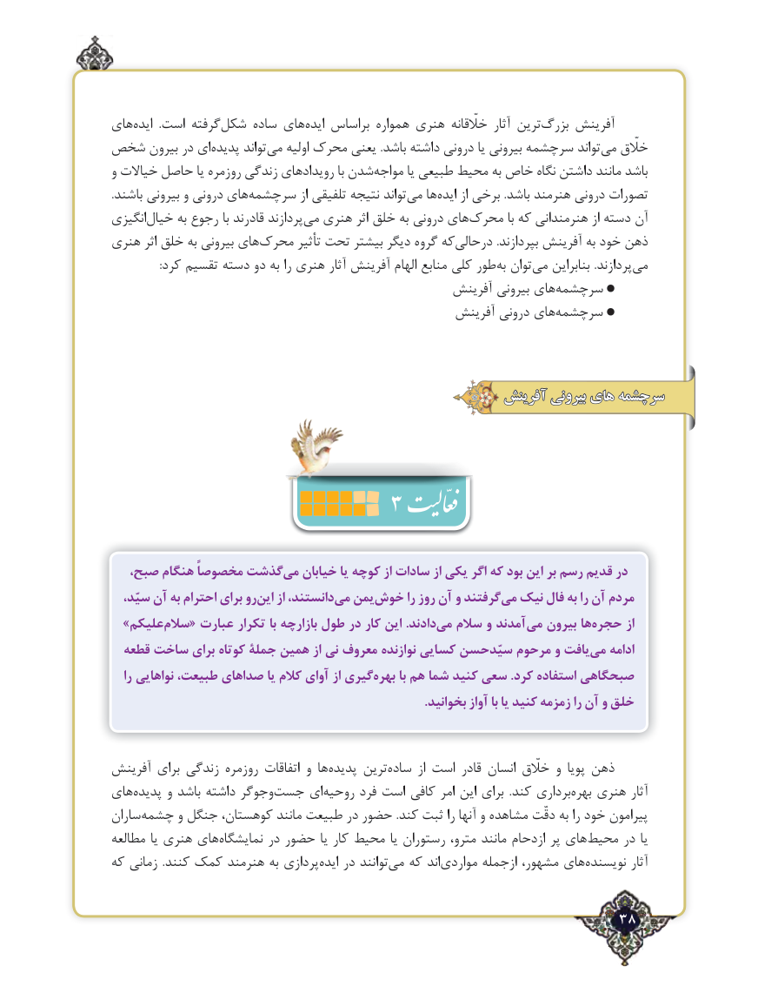

# PDF page 38

های‌ایده  .است گرفتهشکل‌     ساده های‌ایده براساس همواره هنری خلّقانه آثار ترین‌بزرگ آفرینش
شخص بیرون در ای ‌پدیده تواند‌می اولیه محرك یعنی .باشد داشته درونی یا بیرونی سرچشمه تواند ‌می خلّق
و خیاالت حاصل یا روزمره زندگی رویدادهای با شدن ‌مواجه یا طبیعی محیط به خاص نگاه داشتن مانند باشد
.باشند بیرونی و درونی های‌سرچشمه از تلفیقی نتیجه تواند ‌می ها‌ایده از برخی .باشد هنرمند درونی تصورات
انگیزی‌خیال به رجوع با قادرند پردازندمی‌  هنری اثر خلق به درونی های‌محرک با كه هنرمندانی از دسته آن
هنری اثر خلق به بیرونی های‌محرک تأثیر تحت بیشتر دیگر گروه که ‌درحالی .بپردازند آفرینش به خود ذهن
:‌کرد تقسیم دسته دو به را هنری آثار آفرینش الهام منابع کلی طور به توان‌می بنابراین .پردازندمی‌
                                                   آفرینش بیرونی هایسرچشمه‌
                                                    آفرینش درونی های‌سرچشمه

                                                       آفرینش بیرونی های سرچشمه

                         3
 ،گذشتصبح هنگام مخصوصاً     می‌   خیابان یا کوچه از سادات از یکی اگر که بود این بر رسم قدیم در
  سیّد، آن به احترام برای رواین‌    از دانستند،می‌  یمنخوش‌       را روز آن و گرفتندمی‌  نیک فال به را آن مردم
  »علیکمسالم‌   « عبارت تکرار با بازارچه طول در کار این .دادندمی‌   سالم و آمدند می بیرون هاحجره‌       از
  قطعه ساخت برای کوتاه جملۀ همین از نی معروف نوازنده کسایی سیّدحسن مرحوم و یافتمی‌   ادامه
   را نواهایی طبیعت، صداهای یا کالم آوای از گیریبهره‌      با هم شما کنید سعی .کرد استفاده صبحگاهی
                                                                                                    .بخوانید آواز با یا کنید زمزمه را آن و خلق

آفرینش برای زندگی روزمره اتفاقات و ها‌پدیده ترین ‌ساده  از است قادر انسان خلّق و پویا ذهن
های‌پدیده و باشد داشته وجوگرجست‌     ای‌روحیه فرد است کافی امر این برای  .كند برداری‌بهره هنری آثار
ساران‌چشمه و جنگل كوهستان، مانند طبیعت در حضور .كند ثبت را آنها و مشاهده دقّت به را خود پیرامون
مطالعه یا هنری های ‌نمایشگاه در حضور یا كار محیط یا رستوران مترو، مانند ازدحام پر هایمحیط‌     در یا
كه زمانی  .كنند كمك هنرمند به پردازیایده‌   در توانندمی‌  كه اند‌مواردی ازجمله مشهور، های‌نویسنده آثار

                                                         38٢

