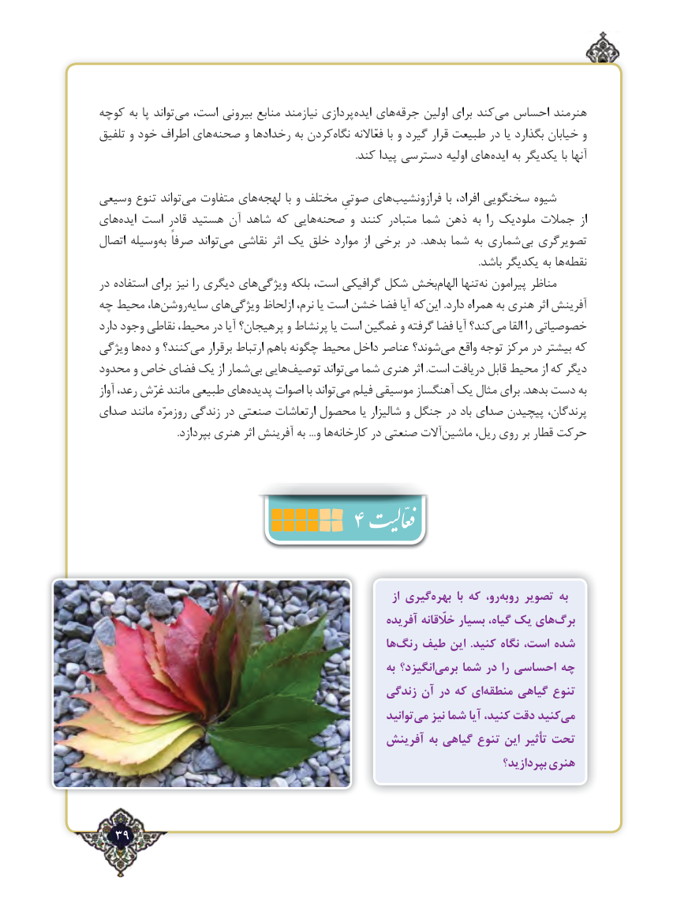

# PDF page 39

كوچه به پا تواند ‌می است، بیرونی منابع نیازمند پردازی‌ایده های‌جرقه اولین برای كندمی‌  احساس هنرمند
تلفیق و خود اطراف های ‌صحنه و رخدادها به كردننگاه‌     فعّاالنه با و گیرد قرار طبیعت در یا بگذارد خیابان و
                                                                                                      .كند پیدا دسترسی اولیه هایایده‌    به یكدیگر با آنها

وسیعی تنوع تواندمی‌   متفاوت های ‌‎لهجه با و مختلف صوتیِ های‌فرازونشیب با افراد، سخنگویی شیوه
های‌ایده است قادر هستید آن شاهد که هاییصحنه‌      و کنند متبادر شما ذهن به را ملودیک جمالت از
اتصال وسیلهبه‌  صرفاً تواند‌می نقاشی اثر یک خلق موارد از برخی در  .بدهد شما به شماری  بی تصویرگری
                                                                                                                                                       .باشد یکدیگر به ها ‌نقطه
در استفاده برای نیز را دیگری هایویژگی‌      بلکه است، گرافیکی شکل بخشالهام‌     تنهانه‌  پیرامون مناظر
چه محیط ها،روشن‌    سایه‌   هایویژگی‌     ازلحاظ نرم، یا است خشن فضا آیا کهاین‌      .دارد همراه به هنری اثر آفرینش
دارد وجود نقاطی محیط، در آیا پرهیجان؟ و پرنشاط یا است غمگین و گرفته فضا آیا کند؟می‌    القا را خصوصیاتی
ویژگی هاده‌  و کنند؟می‌   برقرار ارتباط باهم چگونه محیط داخل عناصر شوند؟می‌   واقع توجه مرکز در بیشتر که
محدود و خاص فضای یک از شماربی‌  هاییتوصیف‌        تواندمی‌  شما هنری اثر .است دریافت قابل محیط از که دیگر
آواز رعد، غرّش مانند طبیعی هایپدیده‌    اصوات با تواندمی‌   فیلم موسیقی آهنگساز یک مثال برای .بدهد دست به
صدای مانند روزمرّه زندگی در صنعتی ارتعاشات محصول یا شالیزار و جنگل در باد صدای پیچیدن پرندگان،
 .‌بپردازد هنری اثر آفرینش به ...و هاکارخانه در صنعتی آالتماشین‌      ریل، روی بر قطار حرکت
                         4

                                                                          از گیریبهره‌       با که رو،روبه‌    تصویر به
                                                      آفریده خلّقانه بسیار گیاه، یک هایبرگ‌
                                                        هارنگ‌   طیف این  .کنید نگاه است، شده ‌
                                                             به انگیزد؟برمی‌    شما در را احساسی چه
                                               زندگی آن در كه ایمنطقه‌     گیاهی تنوع
                                                              توانیدمی‌   نیز شما آیا كنید، دقت کنیدمی‌
                                             آفرینش به گیاهی تنوع این تأثیر تحت
                                                                                  بپردازید؟ هنری

  39٢

