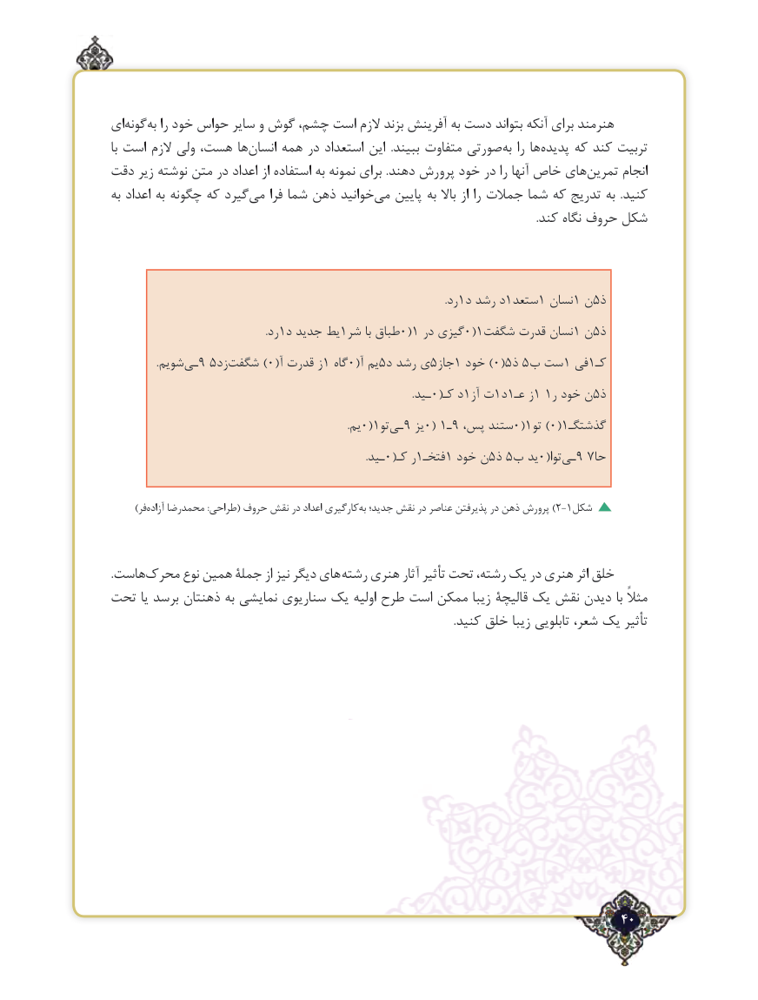

# PDF page 40

ای‌گونهبه‌  را خود حواس سایر و گوش چشم، است الزم بزند آفرینش به دست بتواند آنكه برای هنرمند
با است الزم ولی هست، ها‌انسان همه در استعداد این  .ببیند متفاوت صورتی ‌به را هاپدیده‌    كه كند تربیت
دقت زیر نوشته متن در اعداد از استفاده به نمونه برای .دهند پرورش خود در را آنها خاص های ‌تمرین انجام
به اعداد به چگونه که گیردمی‌    فرا شما ذهن خوانیدمی‌   پایین به باال از را جمالت شما که تدریج به  .کنید
                                                                                                                                                          .کند نگاه حروف شکل

                                                                                                                                   .رد1د رشد د1ستعد1 نسان1 ن5ذ
               .1رد د جدید یط1شر با طباق0(1 در گیزی0(1‌شگفت قدرت نسان1 ن 5ذ
   .‌9شویم ـی 5‌)زدشگفت 0(آ قدرت ز1 گاه0(آ یم5 د رشد ی5جاز1 خود )0(51ذ 5 ب ست  فی1کـ
                             .0(ـید  کـ د1آز ت1د1عـ ز1 1ر خود ن5ذ
                             .0(1یم    تو‌9ـی  یز0( 19ـ ،ستندپس   0(1)تو 0(1گذشتگـ
                        .0(ـید  کـ ر1فتخـ1 خود ن5ذ 5 ب ید0(توا‌9ـی  7حا

   )‌فرآزاده محمدرضا :طراحی( حروف نقش در اعداد کارگیریبه‌)جدید؛ نقش در عناصر پذیرفتن در ذهن پرورش 2-1شکل

.هاست‌محرک نوع همین جملۀ از نیز دیگر های رشته هنری آثار تأثیر تحت رشته، یک در هنری اثر خلق
تحت یا برسد ذهنتان به نمایشی سناریوی یک اولیه طرح است ممکن زیبا قالیچۀ یک نقش دیدن با مثالً
                                                                                                                            .کنید خلق زیبا تابلویی شعر، یک تأثیر

                                                                            40٢

