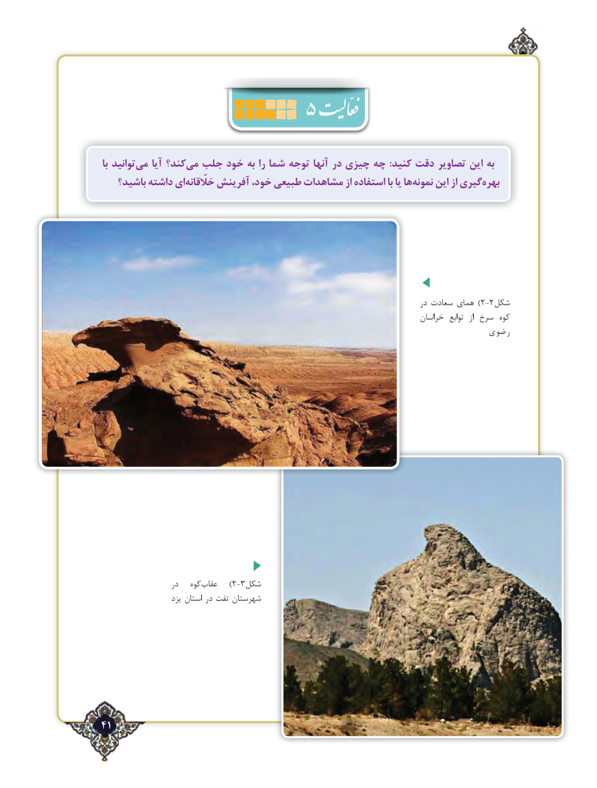

# PDF page 41

با توانیدمی‌    آیا كند؟می‌  جلب خود به را شما توجه آنها در چیزی چه :كنید دقت تصاویر این به
   باشید؟ داشته ایخلّقانه‌     آفرینش خود، طبیعی مشاهدات از استفاده با یا هانمونه‌    این از گیریبهره‌

                                                                                         در سعادت همای )2-2شکل
                                                                                خراسان  توابع  از سرخ کوه
                                                                         رضوی

                    در   کوه‌عقاب    )2-3شکل
                     یزد استان در تفت شهرستان

41٢

