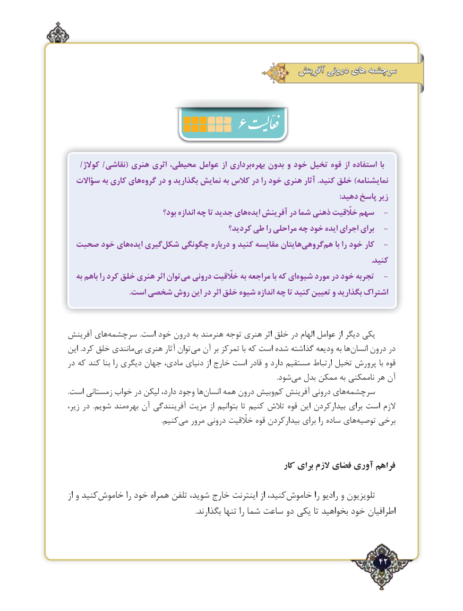

# PDF page 42

آفرینش درونی های سرچشمه
                     6
    /كوالژ /نقاشی( هنری اثری محیطی، عوامل از برداریبهره‌    بدون و خود تخیل قوه از استفاده با
  سؤاالت به كاری هایگروه‌    در و بگذارید نمایش به كالس در را خود هنری آثار .كنید خلق )نمایشنامه
                                                                                                                                              :دهید پاسخ زیر
                            بود؟ اندازه چه تا جدید هایایده‌   آفرینش در شما ذهنی خلّقیت سهم   -
                                          کردید؟ طی را مراحلی چه خود ایده اجرای برای   -
 صحبت خود هایایده‌   گیریشکل‌    چگونگی درباره و کنید مقایسه هایتانگروهی‌    هم‌ با را خود كار  -
                                                                                                                                                              .کنید
   به باهم را کرد خلق هنری اثر توانمی‌  درونی خلّقیت به مراجعه با که ایشیوه‌    مورد در خود تجربه   -
                                .است شخصی روش این در اثر خلق شیوه اندازه چه تا کنید تعیین و بگذارید اشتراک

آفرینش های‌سرچشمه .است خود درون به هنرمند توجه هنری اثر خلق در الهام عوامل از دیگر یكی
این .كرد خلق مانندی‌بی هنری آثار توان ‌می آن بر تمركز با كه است شده ‌گذاشته ودیعه به ها ‌انسان درون در
در که كند بنا را دیگری جهان مادی، دنیای از خارج است قادر و دارد مستقیم ارتباط تخیل پرورش با قوه
                        .‌شودمی بدل ممکن به ناممکنی هر آن
.است زمستانی خواب در لیکن دارد، وجود هاانسان‌    همه درون وبیشکم‌  آفرینش درونی های‌سرچشمه
زیر، در  .شویم مند‌بهره آن آفرینندگی مزیت از بتوانیم تا کنیم تالش قوه این بیدارکردن برای است الزم
          .‌کنیممی مرور درونی خلّقیت قوه بیدارکردن برای را ساده های‌توصیه برخی

                                                        کار برای الزم فضای آوری فراهم

از و کنیدخاموش‌          را خود همراه تلفن شوید، خارج اینترنت از کنید،خاموش‌          را رادیو و تلویزیون
                                                                      .بگذارند تنها را شما ساعت دو یکی تا بخواهید خود اطرافیان

                                                                  42٢

