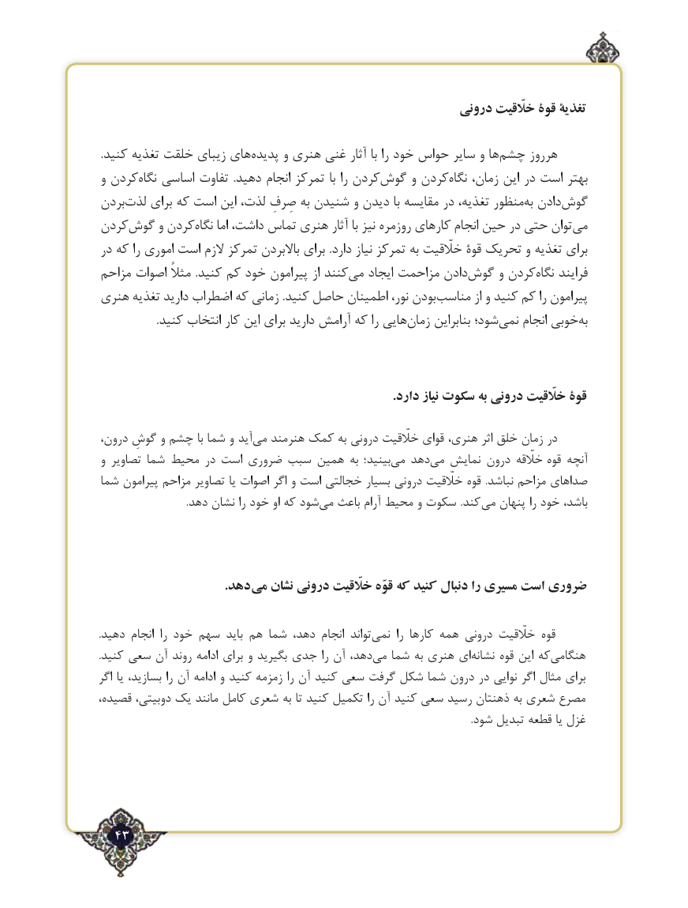

# PDF page 43

درونی خلّقیت قوۀ تغذیۀ

 .کنید تغذیه خلقت زیبای هایپدیده‌     و هنری غنی آثار با را خود حواس سایر و هاچشم‌     هرروز
و کردننگاه‌   اساسی تفاوت  .دهید انجام تمرکز با را کردنگوش‌     و کردننگاه‌    زمان، این در است بهتر
بردنلذت‌    برای که است این لذت، صِرفِ به شنیدن و دیدن با مقایسه در تغذیه، منظوربه‌  دادنگوش‌
کردنگوش‌     و کردننگاه‌     اما داشت، تماس هنری آثار با نیز روزمره کارهای انجام حین در حتی توانمی‌
در که را اموری است الزم تمرکز باالبردن برای .دارد نیاز تمرکز به خلّقیت قوۀ تحریک و تغذیه برای
مزاحم اصوات مثالً  .کنید کم خود پیرامون از کنندمی‌   ایجاد مزاحمت دادنگوش‌     و کردننگاه‌    فرایند
هنری تغذیه دارید اضطراب که زمانی .کنید حاصل اطمینان نور، بودنمناسب‌         از و کنید کم را پیرامون
.‌کنید انتخاب کار این برای دارید آرامش که را هاییزمان بنابراین شود؛نمی‌    انجام خوبیبه‌

                                                                                          .دارد نیاز سکوت به درونی خلّقیت قوۀ

درون، گوشِ و چشم با شما و آید‌می هنرمند کمک به درونی خلّقیت قوای هنری، اثر خلق زمان در
و تصاویر شما محیط در است ضروری سبب همین به بینید؛می‌   دهدمی‌   نمایش درون خلّقه قوه آنچه
شما پیرامون مزاحم تصاویر یا اصوات اگر و است خجالتی بسیار درونی خلّقیت قوه  .نباشد مزاحم صداهای
 .‌دهد نشان را خود او که شودمی باعث آرام محیط و سکوت .کند  می پنهان را خود باشد،

         . دهد می نشان درونی خلّقیت قوّه که کنید دنبال را مسیری است ضروری

.دهید انجام  را خود سهم باید هم شما دهد، انجام تواند‌نمی  را کارها همه درونی خلّقیت قوه
.کنید سعی آن روند ادامه برای و بگیرید جدی را آن دهد،می‌   شما به هنری ای‌نشانه قوه این کههنگامی‌
اگر یا بسازید، را آن ادامه و کنید زمزمه را آن کنید سعی گرفت شکل شما درون در نوایی اگر مثال برای
قصیده، دوبیتی، یک مانند کامل شعری به تا کنید تکمیل را آن کنید سعی رسید ذهنتان به شعری مصرع
                                                                                                                                                    .شود تبدیل قطعه یا غزل

  43٢

