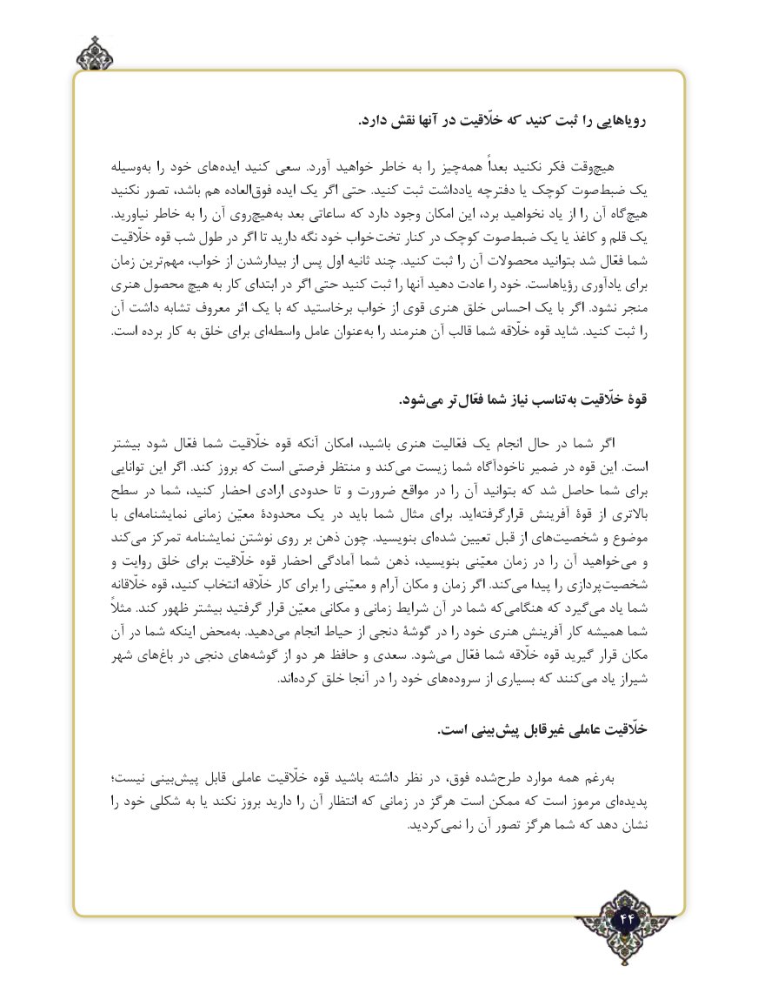

# PDF page 44

.دارد نقش آنها در خلّقیت که کنید ثبت را رویاهایی

وسیله ‌به را خود های ایده کنید سعی  .آورد خواهید خاطر به را چیزهمه‌      بعداً نکنید فکر وقت‌هیچ
نکنید تصور باشد، هم العاده‌فوق ایده یک اگر حتی  .کنید ثبت یادداشت دفترچه یا کوچک صوت ‌ضبط یک
.نیاورید خاطر به را آن روی ‌هیچبه‌  بعد ساعاتی که دارد وجود امکان این برد، نخواهید یاد از را آن گاه ‌هیچ
خلّقیت قوه شب طول در اگر تا دارید ‌نگه خود خواب تخت کنار در کوچک صوت ‌ضبط یک یا کاغذ و قلم یک
زمان ترین‌مهم خواب، از بیدارشدن از پس اول ثانیه چند  .کنید ثبت را آن محصوالت بتوانید شد فعّال شما
هنری محصول هیچ به کار ابتدای در اگر حتی کنید ثبت را آنها دهید عادت را خود .رؤیاهاست یادآوری برای
آن داشت تشابه معروف اثر یک با که برخاستید خواب از قوی هنری خلق احساس یک با اگر  .نشود منجر
.است برده کار به خلق برای ای‌واسطه عامل عنوان به را هنرمند آن قالب شما خلّقه قوه شاید .کنید ثبت را

                   .‌شودمی تر ‌فعّال شما نیاز تناسب‌به خلّقیت قوۀ

بیشتر شود فعّال شما خلّقیت قوه آنکه امکان باشید، هنری فعّالیت یک انجام حال در شما اگر
توانایی این اگر  .کند بروز که است فرصتی منتظر و کند می‌  زیست شما ناخودآگاه ضمیر در قوه این  .است
سطح در شما کنید، احضار ارادی حدودی تا و ضرورت مواقع در را آن بتوانید که شد حاصل شما برای
با ای ‌نمایشنامه زمانی معیّن محدودۀ یک در باید شما مثال ‌ برای  .اید‌قرارگرفته آفرینش قوۀ  از باالتری
کندمی‌   تمرکز نمایشنامه نوشتن روی بر ذهن چون  .بنویسید ای ‌شده ‌تعیین قبل از های‌شخصیت و موضوع
و روایت خلق برای خلّقیت قوه احضار آمادگی شما ذهن بنویسید، معیّنی زمان در را آن خواهید می و
خلّقانه قوه کنید، انتخاب خلّقه کار برای را معیّنی و آرام مکان و زمان اگر .کند ‌می پیدا را پردازی‌شخصیت
مثالً .کند ظهور بیشتر گرفتید قرار معیّن مکانی و زمانی شرایط آن در شما که هنگامی‌      که گیردمی‌   یاد شما
آن در شما اینکه محض ‌به  .دهیدمی‌   انجام حیاط از دنجی گوشۀ در را خود هنری آفرینش کار همیشه شما
شهر های ‌باغ در دنجی های‌گوشه از دو هر حافظ و سعدی  .شود ‌می فعّال شما خلّقه قوه گیرید قرار مکان
                .‌اندکرده خلق آنجا در را خود های‌سروده از بسیاری که کنندمی‌   یاد شیراز

                                                                                          .است بینی پیش غیرقابل عاملی خلّقیت

نیست؛ بینیپیش‌     قابل عاملی خلّقیت قوه باشید داشته نظر در فوق، شده‌طرح موارد همه رغم ‌به
را خود شکلی به یا نکند بروز دارید را آن انتظار که زمانی در هرگز است ممکن که است مرموز ای ‌پدیده
                .‌کردید نمی را آن تصور هرگز شما که دهد نشان

                                                                 44٢

