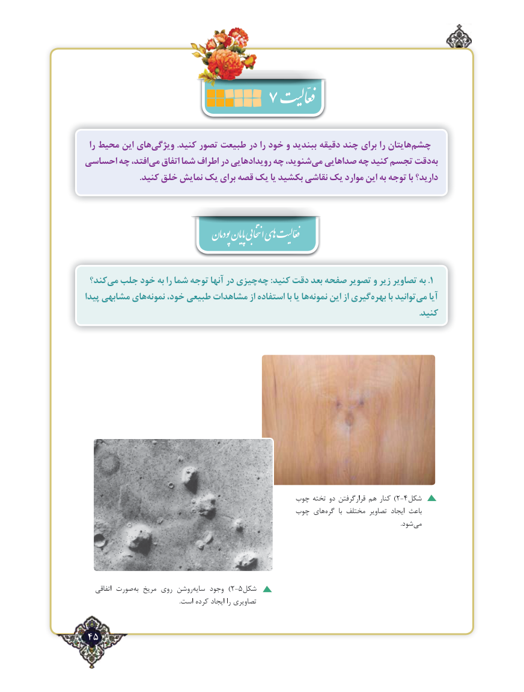

# PDF page 45

را محیط این هایویژگی‌           .كنید تصور طبیعت در را خود و ببندید دقیقه چند برای را هایتانچشم‌
احساسی چه افتد،می‌   اتفاق شما اطراف در رویدادهایی چه شنوید،می‌  صداهایی چه كنید تجسم دقتبه‌
                         .كنید خلق نمایش یك برای قصه یك یا بكشید نقاشی یك موارد این به توجه با دارید؟

                                         پودمان پایان انتخابی اهی  فعّالیت

 كند؟می‌  جلب خود به را شما توجه آنها در چیزیچه‌     :كنید دقت بعد صفحه تصویر و زیر تصاویر به .1
پیدا مشابهی هاینمونه‌    خود، طبیعی مشاهدات از استفاده با یا هانمونه‌    این از گیریبهره‌      با توانیدمی‌   آیا
                                                                                                                                                          .کنید

                                             چوب تخته دو قرارگرفتن هم کنار )2- 4شکل
                                             چوب های ‌گره  با مختلف تصاویر ایجاد باعث
                                                                                                                                                                                                                       .شود‌می

    اتفاقی صورتبه‌  مریخ روی روشن‌)سایه وجود  2-5شکل
                                                                .است کرده ایجاد را تصاویری

 45٢

