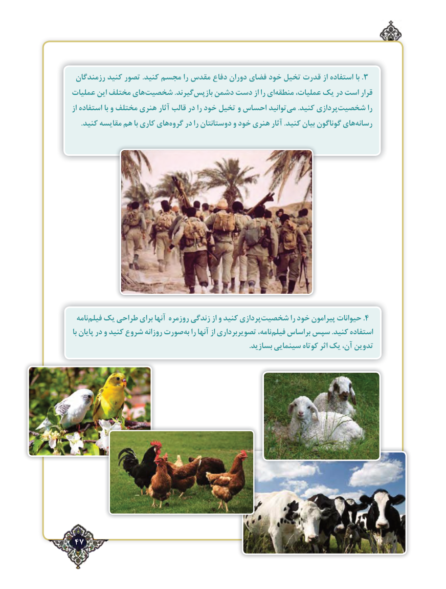

# PDF page 47

رزمندگان کنید تصور .کنید مجسم را مقدس دفاع دوران فضای خود تخیل قدرت از استفاده با . 3
عملیات این مختلف هایشخصیت‌               .گیرندبازپس‌    دشمن دست از را ایمنطقه‌     عملیات، یک در است قرار
از استفاده با و مختلف هنری آثار قالب در را خود تخیل و احساس توانیدمی‌     .کنید پردازیشخصیت‌           را
     .كنید مقایسه هم با كاری هایگروه‌    در را دوستانتان و خود هنری آثار .كنید بیان گوناگون هایرسانه‌

  نامهفیلم‌  یک طراحی برای آنها روزمره زندگی از و کنید پردازیشخصیت‌.را خود پیرامون حیوانات 4
با پایان در و کنید شروع روزانه صورتبه‌  را آنها از تصویربرداری نامه،فیلم‌   براساس سپس .کنید استفاده
                                                                                                .بسازید سینمایی کوتاه اثر یک ،تدوینآن

 47٢

