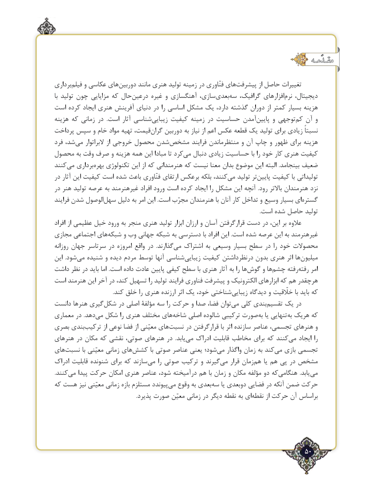

# PDF page 50

مقـدّمـه

برداری‌فیلم و عکاسی های‌دوربین مانند هنری تولید زمینه در فنّاوری های‌پیشرفت از حاصل تغییرات
با تولید چون مزایایی که حال‌درعین غیره و آهنگسازی سازی،‌بعدی ‌سه گرافیک، افزارهای‌نرم دیجیتال،
است کرده ایجاد هنری آفرینش دنیای در را اساسی مشکل یک دارد، گذشته دوران از کمتر بسیار هزینه
هزینه که زمانی در  .است آثار شناسیزیبایی‌     کیفیت زمینه در حساسیت آمدن‌پایین و توجهی ‌کم آن و
پرداخت سپس و خام مواد تهیه قیمت،‌گران دوربین به نیاز از اعم عکس قطعه یک تولید برای زیادی نسبتاً
فرد شد،‌می البراتوار از خروجی محصول شدن‌مشخص فرایند منتظرماندن و آن چاپ و ظهور برای هزینه
محصول به وقت صرف و هزینه همه ‌این مبادا تا کردمی‌   دنبال زیادی حساسیت با را خود کار هنری کیفیت
کنندمی‌   برداریبهره‌    تکنولوژی این از که هنرمندانی که نیست معنا بدان موضوع این البته  .بینجامد ضعیف
در آثار این کیفیت است شده باعث فنّاوری ارتقای برعکس بلکه کنند،می‌   تولید تر ‌پایین کیفیت با تولیداتی
در هنر تولید عرصه به غیرهنرمند افراد ورود است کرده ایجاد را مشکل این آنچه  .رود باالتر هنرمندان نزد
فرایند شدن الوصول‌سهل دلیل به امر این .است مجرّب هنرمندان با آنان کار تداخل و وسیع بسیار ای ‌گستره
                                                                                                                                                       .است شده حاصل تولید
افراد از عظیمی خیل ورود به منجر هنری تولید ابزار ارزان و آسان قرارگرفتن دست در این، بر عالوه
مجازی اجتماعی های ‌شبکه و وب جهانی شبکه به دسترسی با افراد این .است شده عرصه این به غیرهنرمند
روزانه جهان سرتاسر در امروزه واقع در  .گذارندمی‌   اشتراک به وسیعی بسیار سطح در را خود محصوالت
این  .شود‌می شنیده و دیده مردم توسط آنها شناسی‌زیبایی کیفیت درنظرداشتن بدون هنری اثر ها‌میلیون
داشت نظر در باید اما .است داده عادت پایین کیفی سطح با هنری آثار به را ها ‌گوش و هاچشم‌     رفتهرفته‌     امر
است هنرمند این آخر در کند، تسهیل را تولید فرایند فناوری پیشرفت و الکترونیک ابزارهای که هم هرچقدر
                                           .کند خلق را هنری ارزنده اثر یک خود، شناختیزیبایی‌      دیدگاه و خلّقیت با باید که
دانست هنرها گیریشکل‌    در اصلی مؤلفۀ سه را حرکت و صدا فضا، توان‌می کلی بندیتقسیم‌    یک در
معماری در .دهد‌می شکل را هنری مختلف هایشاخه‌    اصلی شالوده ترکیبی صورت ‌به یا تنهایی ‌به هریک که
بصری بندی‌ترکیب از نوعی فضا از معیّنی های‌نسبت در قرارگرفتن با اثر سازنده عناصر تجسمی، هنرهای و
هنرهای در مکان که نقشی صوتی، هنرهای در  .یابد ‌می ادراک قابلیت مخاطب برای که کنندمی‌   ایجاد را
های‌نسبت با معیّنی زمانی های‌کشش با صوتی عناصر یعنی شود؛‌می واگذار زمان به کندمی‌   بازی تجسمی
ادراک قابلیت شنونده برای که سازند‌می را صوتی ترکیب و گیرندمی‌    قرار زمان ‌هم یا هم‌ پی در مشخص
.کنندمی‌   پیدا حرکت امکان هنری عناصر شود، درآمیخته هم با زمان و مکان مؤلفه دو کههنگامی‌              .یابد ‌می
که هست نیز معیّنی زمانی بازه مستلزم پیونددمی‌   وقوع به بعدی ‌سه یا دوبعدی فضایی در آنکه ضمن حرکت
 .‌پذیرد صورت معیّن زمانی در دیگر نقطه به اینقطه از حرکت آن براساس

                                                                         50٢

