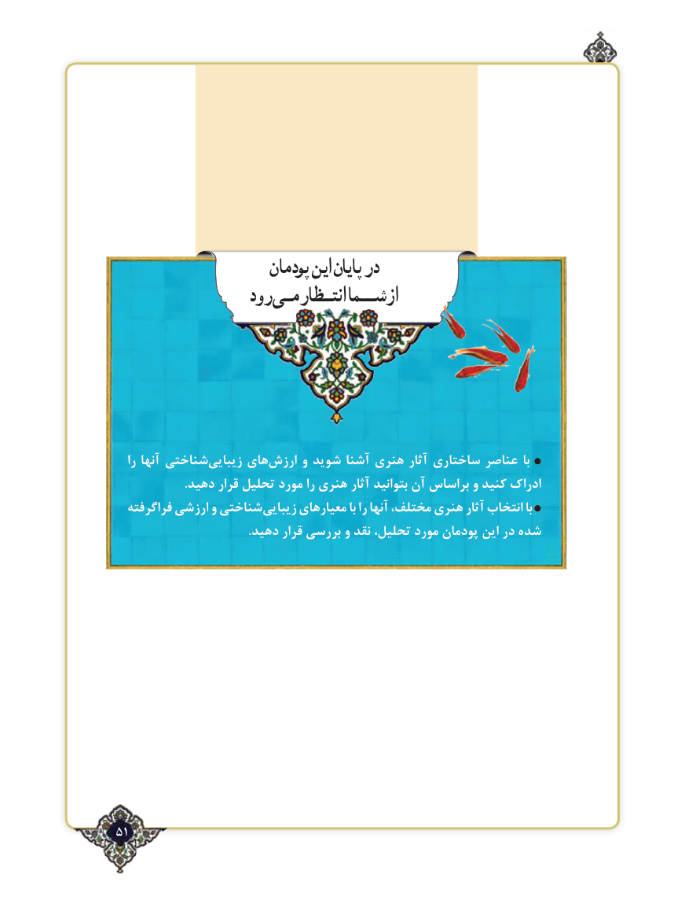

# PDF page 51

پودمان اینپایان در
                 رود انتـظارمـیشــمااز

   را آنها شناختیزیبایی‌     های ‌ارزش و شوید آشنا هنری آثار ساختاری عناصر با
                      .دهید قرار تحلیل مورد را هنری آثار بتوانید آن براساس و کنید ادراک
  فراگرفته ارزشی و شناختیزیبایی‌      معیارهای با را آنها مختلف، هنری آثار انتخاب با
                                           .دهید قرار بررسی و نقد تحلیل، مورد پودمان این در شده

51٢

