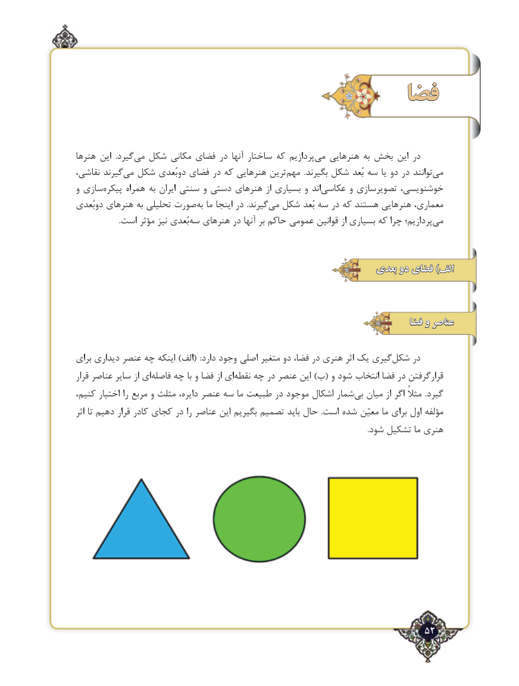

# PDF page 52

فضا

هنرها این  .گیردمی‌  شکل مکانی فضای در آنها ساختار که پردازیم‌می هنرهایی به بخش این در
نقاشی، گیرندمی‌  شکل دوبُعدی فضای در که هنرهایی ترین ‌مهم  .بگیرند شکل بُعد سه یا دو در توانند‌می
و سازی ‌پیکره همراه به ایران سنتی و دستی هنرهای از بسیاری و اند ‌عکاسی و تصویرسازی خوشنویسی،
دوبُعدی هنرهای به تحلیلی صورت ‌به ما اینجا در  .گیرندمی‌  شکل بُعد سه در که هستند ‌هنرهایی معماری،
 .‌است مؤثر نیز بُعدی سه هنرهای در آنها بر حاکم عمومی قوانین از بسیاری که چرا پردازیم؛ ‌می

                                                          بعدی دو فضای )الف

                                                                            فضا و عناصر

برای دیداری عنصر چه اینکه )الف(  :دارد وجود اصلی متغیر دو فضا، در هنری اثر یک گیریشکل‌    در
قرار عناصر سایر از ای‌فاصله چه با و فضا از ای ‌نقطه چه در عنصر این )ب( و شود انتخاب فضا در قرارگرفتن
کنیم، اختیار را مربع و مثلث دایره، عنصر سه ما طبیعت در موجود اشکال شمار ‌بی میان از اگر مثالً  .گیرد
اثر تا دهیم قرار کادر کجای در را عناصر این بگیریم تصمیم باید حال  .است شده معیّن ما برای اول مؤلفه
                                                                                                                                                          .شود تشکیل ما هنری

                                                                52٢

