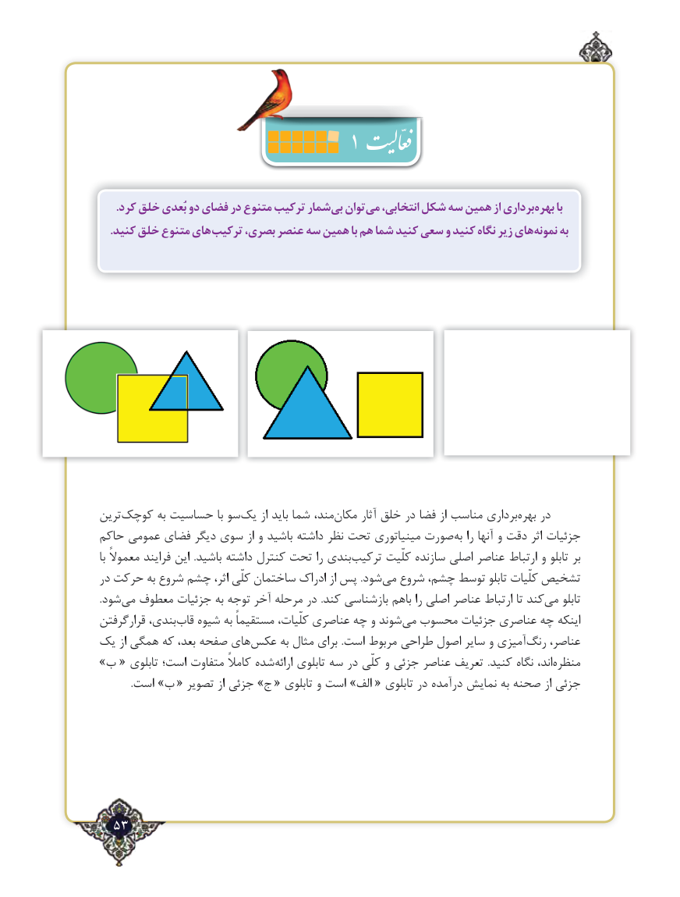

# PDF page 53

.کرد خلق بُعدی دو فضای در متنوع ترکیب شماربی‌  توانمی‌   انتخابی، شکل سه همین از برداریبهره‌      با
. کنید خلق متنوع های ترکیب بصری، عنصر سه همین با هم شما کنید سعی و کنید نگاه زیر هاینمونه‌     به

ترین ‌کوچک به حساسیت با سو‌یک از باید شما مند،‌مکان آثار خلق در فضا از مناسب برداری‌بهره در
حاکم عمومی فضای دیگر سوی از و باشید داشته نظر تحت مینیاتوری صورت‌به را آنها و دقت اثر جزئیات
با معموالً فرایند این  .باشید داشته کنترل تحت را بندی‌ترکیب کلّیت سازنده اصلی عناصر ارتباط و تابلو بر
در حرکت به شروع چشم اثر، کلّی ساختمان ادراک از پس .شود‌می شروع چشم، توسط تابلو کلّیات تشخیص
.شود ‌می معطوف جزئیات به توجه آخر مرحله در .کند بازشناسی باهم را اصلی عناصر ارتباط تا کند‌می تابلو
قرارگرفتن بندی، ‌قاب شیوه به مستقیماً کلّیات، عناصری چه و شوند‌می محسوب جزئیات عناصری چه اینکه
یک از همگی که بعد، صفحه های‌عکس به مثال برای .است مربوط طراحی اصول سایر و آمیزی‌رنگ عناصر،
»ب « تابلوی است؛ متفاوت کامالً شده ‌ارائه تابلوی سه در کلّی و جزئی عناصر تعریف  .کنید نگاه اند، ‌منظره
             .است »ب « تصویر از جزئی »ج « تابلوی و است »الف « تابلوی در درآمده نمایش به صحنه از جزئی

  53٢

