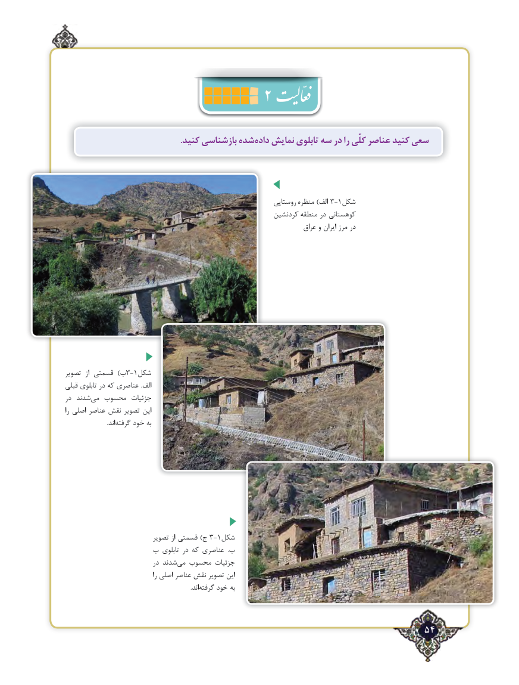

# PDF page 54

.کنید بازشناسی شدهداده‌   نمایش تابلوی سه در را کلّی عناصر کنید سعی

                                                                روستایی منظره )الف 3-1شکل
                                                          کردنشین منطقه در کوهستانی
                                                                          عراق و ایران مرز در

تصویر  از قسمتی  )ب3-1شکل
قبلی تابلوی در که عناصری  .الف
در شدند ‌می محسوب جزئیات
را اصلی عناصر نقش تصویر این
        .‌اند گرفته خود به

                            تصویر از قسمتی )ج 3-1شکل
               ب تابلوی در که عناصری  .ب
                            در شدند‌می محسوب جزئیات
                                          را اصلی عناصر نقش تصویر این
                        .‌اندگرفته خود به

                                                                54٢

