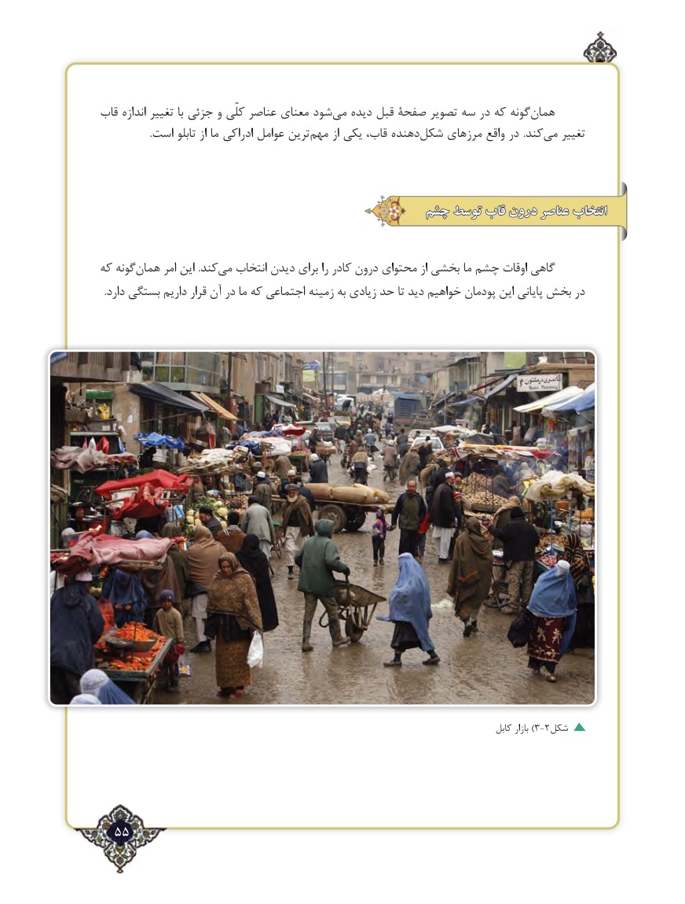

# PDF page 55

قاب اندازه تغییر با جزئی و کلّی عناصر معنای شود‌می دیده قبل صفحۀ تصویر سه در که گونههمان‌
                    .است تابلو از ما ادراکی عوامل ترین ‌مهم از یکی قاب، دهنده‌شکل مرزهای واقع در .کند‌می تغییر

                                         چشمچشم توسطتوسط قابقاب دروندرون عناصرعناصر انتخابانتخاب

که گونههمان‌      امر این .کندمی‌   انتخاب دیدن برای را کادر درون محتوای از بخشی ما چشم اوقات گاهی
  .دارد بستگی داریم قرار آن در ما که اجتماعی زمینه به زیادی حد تا دید خواهیم پودمان این پایانی بخش در

                                                                                                  کابل بازار )3-2شکل

  55٢

