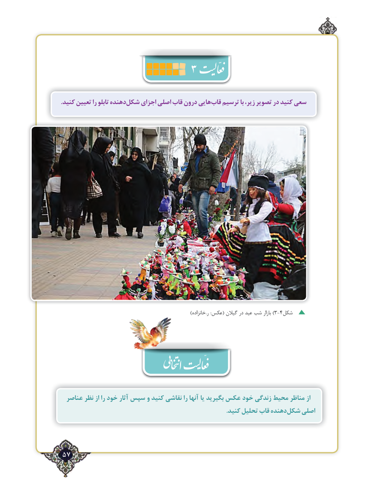

# PDF page 57

.کنید تعیین را تابلو دهندهشکل‌    اجزای اصلی قاب درون هاییقاب‌   ترسیم با زیر، تصویر در کنید سعی

   ))خانزاده.ر :عکس( گیالن در عید شب بازار 3-4شکل

  عناصر نظر از را خود آثار سپس و کنید نقاشی را آنها یا بگیرید عکس خود زندگی محیط مناظر از
     .‌کنید تحلیل قاب دهنده    اصلی                                شکلّ

57٢

