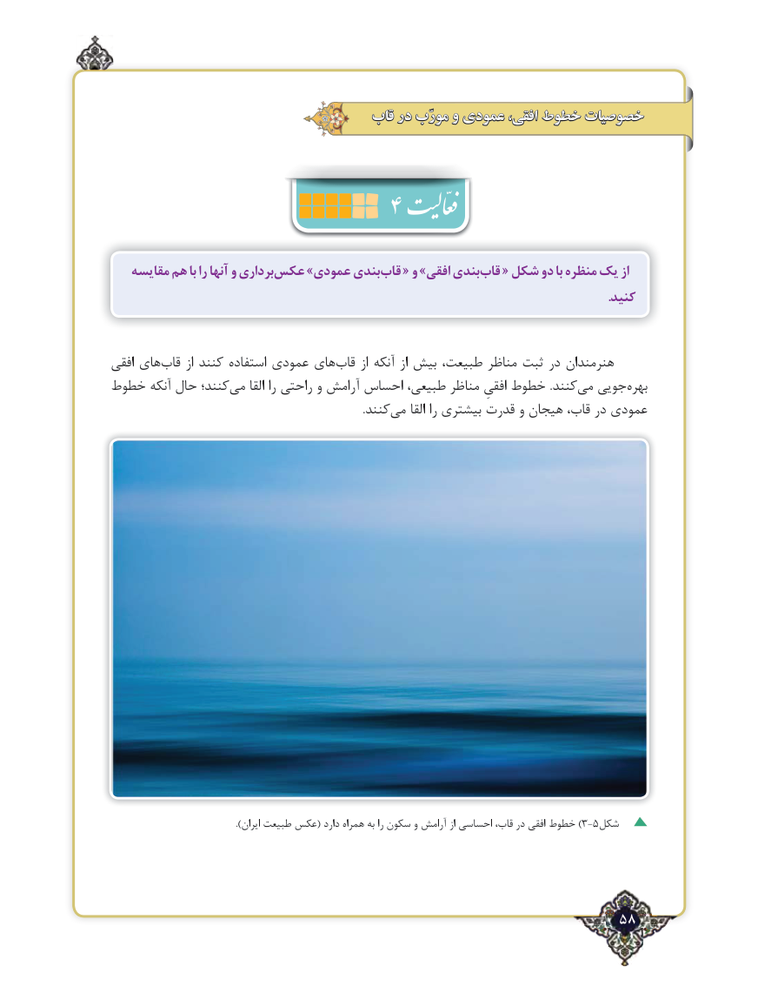

# PDF page 58

قاب در مورّب و عمودی افقی، خطوط خصوصیات
                         4
   مقایسه هم با را آنها و برداریعکس‌     »عمودی بندیقاب‌   « و »افقی بندیقاب‌   « شکل دو با منظره یک از
                                                                                                                                                              .کنید

افقی های‌قاب از کنند استفاده عمودی های‌قاب از آنکه از بیش طبیعت، مناظر ثبت در هنرمندان
خطوط آنکه ‌حال کنند؛می‌    القا را راحتی و آرامش احساس طبیعی، مناظر افقیِ خطوط .کنند‌می جویی ‌بهره
                .‌کنندمی القا را بیشتری قدرت و هیجان قاب، در عمودی

 .))ایران طبیعت عکس( دارد همراه به را سکون و آرامش از احساسی قاب، در افقی خطوط 3-5شکل

                                                           58٢

