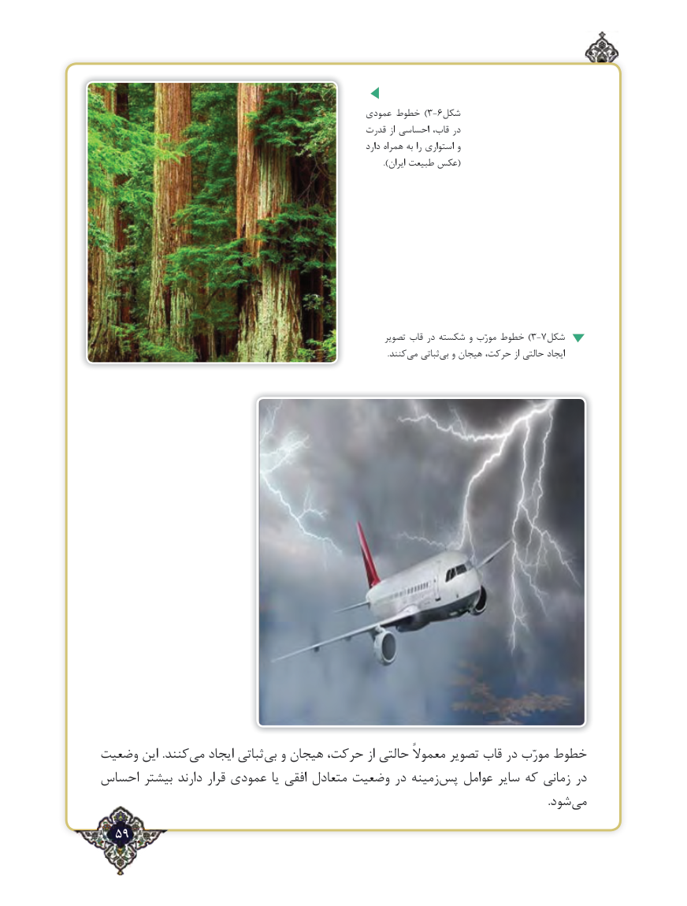

# PDF page 59

عمودی خطوط )3-6شکل
                                                    قدرت از احساسی قاب، در
                                                                         دارد همراه به را استواری و
                                                                                                            ).ایران طبیعت عکس(

                                                                   تصویر قاب در شکسته و مورّب خطوط )3-7شکل
                          .‌کنندمی ثباتی ‌بی و هیجان حرکت، از حالتی ایجاد

وضعیت این .کنندمی‌   ایجاد ثباتی‌بی و هیجان حرکت، از حالتی معموالً تصویر قاب در مورّب خطوط
احساس بیشتر دارند قرار عمودی یا افقی متعادل وضعیت در زمینهپس‌   عوامل سایر که زمانی در
                                .‌شودمی
  59٢

