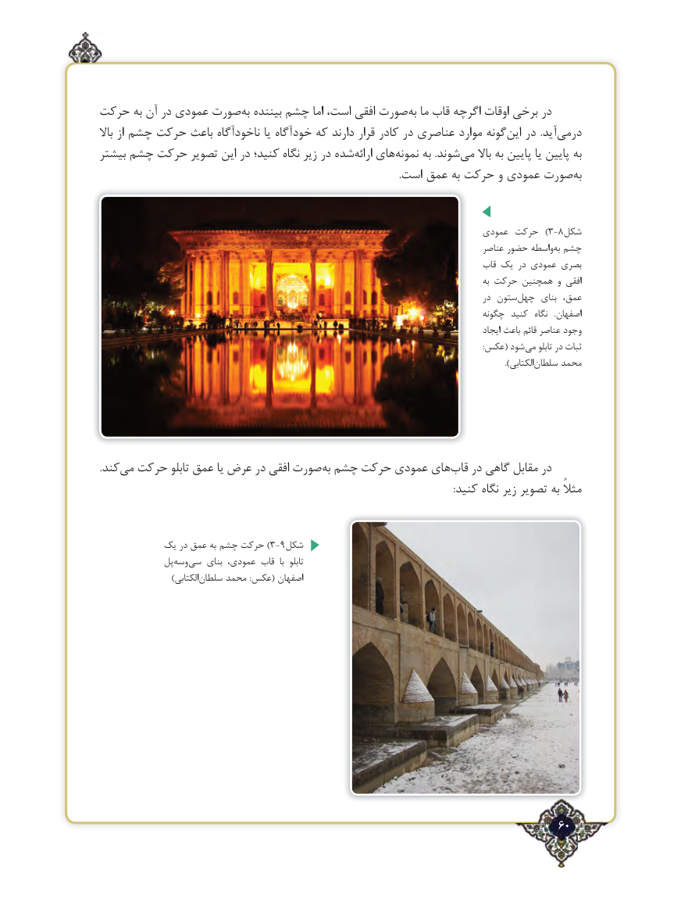

# PDF page 60

حرکت به آن در عمودی صورت‌به بیننده چشم اما است، افقی صورت ‌به ما قاب اگرچه اوقات برخی در
باال از چشم حرکت باعث ناخودآگاه یا خودآگاه که دارند قرار کادر در عناصری موارد گونه‌این در  .آید‌درمی
بیشتر چشم حرکت تصویر این در کنید؛ نگاه زیر در شده ‌ارائه های‌نمونه به .شوند‌می باال به پایین یا پایین به
   .‌است عمق به حرکت و عمودی صورت به

                                                                          عمودی حرکت  )3-8شکل
                                                                                          عناصر حضور واسطه ‌به چشم
                                                                                    قاب یک در عمودی بصری
                                                                                                                 به حرکت همچنین و افقی
                                                                                              در ستون ‌چهل  بنای عمق،
                                                                                       چگونه کنید  نگاه   .اصفهان
                                                                                                           ایجاد باعث قائم عناصر وجود
                                                                                                                                                                                                         :عکس( شود ‌می تابلو در ثبات
                                      ).‌الکتابی سلطان محمد

.کندمی‌  حرکت تابلو عمق یا عرض در افقی صورت‌به چشم حرکت عمودی های ‌قاب در گاهی مقابل در
                                                                                                                                              :کنید نگاه زیر تصویر به مثالً

          یک در عمق به چشم حرکت )3-9شکل
             پلوسه‌    ‌سی بنای عمودی، قاب  با  تابلو
     )‌الکتابیسلطان محمد :عکس( اصفهان

                                                                  ٢60

