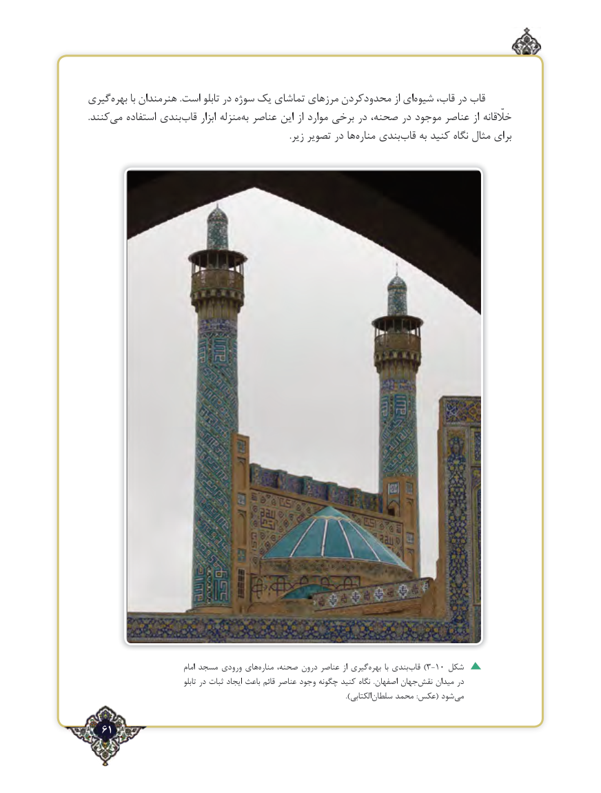

# PDF page 61

گیری‌بهره با هنرمندان .است تابلو در سوژه یک تماشای مرزهای محدودکردن از ای‌شیوه قاب، در قاب
.کنندمی‌   استفاده بندی‌قاب ابزار منزله‌به عناصر این از موارد برخی در صحنه، در موجود عناصر از خلّقانه
      .‌زیر تصویر در ها مناره بندی ‌قاب به کنید نگاه مثال برای

                                  امام مسجد ورودی های‌مناره صحنه، درون عناصر از گیری ‌بهره  با بندی‌)قاب 3-10 شکل
                                      تابلو در ثبات ایجاد باعث قائم عناصر وجود چگونه کنید نگاه  .اصفهان جهان‌نقش میدان در
                           ).‌الکتابیسلطان محمد :عکس( شود ‌می

   61٢

